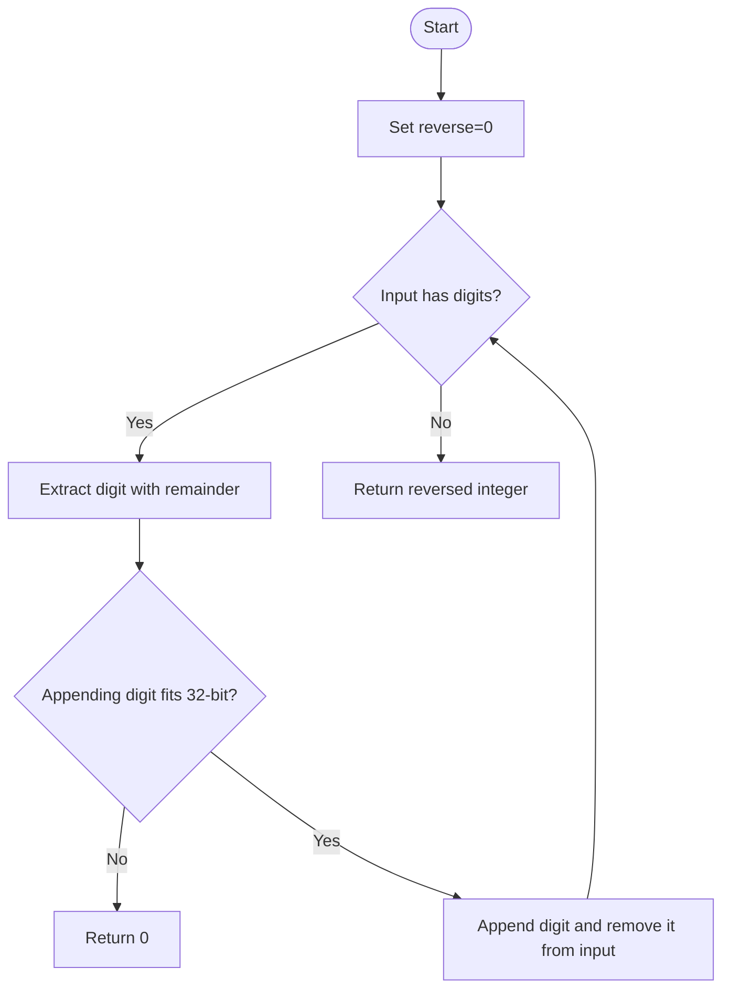

# Reverse Integer — LeetCode 7

## 1. Understanding

32-bit signed integer चे decimal digits उलटवा; reversed value range बाहेर गेल्यास `0` द्या. Source मध्ये arithmetic, `long long`, आणि string methods आहेत.

## 2. Worked examples and edges

- `123` → `321`; `-123` → `-321`; `120` → `21`.
- `1534236469` reverse केल्यास overflow → 0.
- `0` → 0; `INT_MIN` absolute value edge case आहे.

## 3. Pattern identification + cheat sheet

| Clue                      | Pattern                  | कारण                                 |
| ------------------------- | ------------------------ | ------------------------------------ |
| Decimal digits क्रम बदलणे | `%10`, `/10`             | शेवटचा digit काढतो                   |
| Fixed-width signed result | Overflow guard           | प्रत्येक append सुरक्षित ठेवा        |
| String conversion         | Alternate representation | सोपे, पण parsing/range checks आवश्यक |

## 4. Approaches

- `reverseMath`: digit-by-digit; O(d) time/O(1), पण source guard फक्त `rev` limit तपासतो—last digit boundary तपासत नाही, म्हणून signed overflow boundary पूर्णपणे सुरक्षित नाही.
- `reverseUsingLongLong`: widened accumulator नंतर range check; O(d), O(1), सामान्य int input साठी योग्य.
- String: O(d) time/O(d) space; source चे `abs(x)` `INT_MIN` वर int overflow करतो, त्यामुळे हा implementation त्या input साठी सुरक्षित नाही.
- Correct robust math check: append करण्याआधी `rev > INT_MAX/10` किंवा equality आणि digit `>7`; negative साठी `rev < INT_MIN/10` किंवा equality आणि digit `<-8`.

## 5. Flowchart

Boundary check append करण्याआधी करा; overflow झाल्यावर value आधीच corrupt होऊ शकते.

## 6. Algorithm / intuition

`digit=x%10`, मग `x/=10`; accumulator `rev=rev*10+digit`. Sign remainder मध्येच टिकतो. प्रत्येक append नंतर result 32-bit range मध्ये असणे आवश्यक.

## 7. Code explanation

Source चे public methods `reverseMath`, `reverseUsingLongLong`, `reverseUsingString`. Widened version अंतिम range तपासतो; इतर दोनमधील वर नमूद केलेले boundary defects समजून घ्या. `main()` test values तिन्ही implementations शी तुलना करतो.

## 8. Dry run

`x=-120`:
| digit | rev आधी | rev नंतर | x नंतर |
|---:|---:|---:|---:|
| 0 | 0 | 0 | -12 |
| -2 | 0 | -2 | -1 |
| -1 | -2 | -21 | 0 |
| | | return `-21` | |

## 9. Complexity

> **मराठी:** Input size आणि प्रत्येक operation कितीदा चालतो यावरून complexity ठरवा.
> `d` digits: arithmetic O(d) time/O(1) space; string method O(d) time/O(d) space. Overflow check constant per digit.

## 10. Correctness

प्रत्येक iteration नंतर `rev` हा आतापर्यंत घेतलेल्या input digits चा उलटा prefix असतो आणि `x` मध्ये न घेतलेले digits उरतात. सर्व digits घेतल्यावर तोच reversed number; तो range बाहेर असल्यास spec नुसार 0.

## 11. Mistakes and interview traps

- फक्त `rev > INT_MAX/10` तपासणे अपुरे; अंतिम digit boundary देखील तपासा.
- `INT_MIN` चे `abs(int)` सुरक्षित नाही.
- Negative modulo digit C++ मध्ये negativeच राहू शकतो; ते योग्य आहे.
- Leading zeros उलटल्यावर स्वाभाविकपणे नाहीसे होतात.

## 12. Quick revision

> **मराठी:** दोन मिनिटांच्या revision साठी pattern, मुख्य कल्पना आणि complexity आठवा.
> Digit extract → overflow precheck → append → divide. Final 32-bit range; overflow means 0.

## 13. Related problems / variations

> **मराठी:** प्रश्नात काय दिले आहे आणि नेमके काय शोधायचे आहे, हे आधी स्पष्ट करा.
> Palindrome Number, String to Integer (atoi), reverse digits in arbitrary base, checked arithmetic.

## 14. Self-assessment

1. `x%10` आणि `x/10` काय देतात?
2. `INT_MAX` चा शेवटचा digit 7 का महत्त्वाचा?
3. `INT_MIN` साठी `abs` trap काय?
4. Overflow precheck append च्या आधी का?
