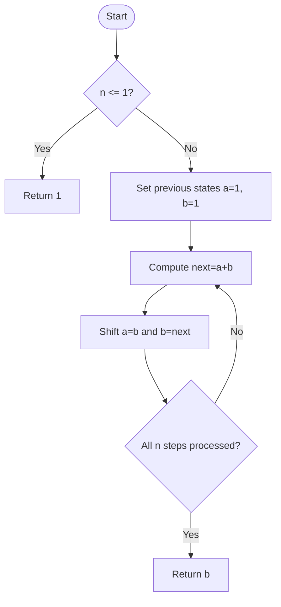

# Climbing Stairs — LeetCode 70

## 1. Understanding

`n` पायऱ्यांपर्यंत 1 किंवा 2 steps घेऊन जाण्याचे किती distinct मार्ग आहेत ते मोजा. Source iterative Fibonacci आणि vector DP देतो.

## 2. Worked examples and edges

- `n=1` → 1; `n=2` → 2; `n=3` → 3.
- `n=0` source दोन्ही methods मध्ये 1 देतो (empty climb चे एक मार्ग); LeetCode constraints साधारण `n>=1`.
- मोठ्या `n` वर `int` overflow होऊ शकतो; judge boundsमध्ये result बसतो.

## 3. Pattern identification + cheat sheet

| Clue                        | Pattern              | कारण                          |
| --------------------------- | -------------------- | ----------------------------- |
| Count ways to reach step    | Dynamic programming  | शेवटचा move 1 किंवा 2         |
| Two previous states suffice | Fibonacci recurrence | `ways[i]=ways[i-1]+ways[i-2]` |
| Need only final count       | State compression    | दोन variables पुरेसे          |

## 4. Approaches

- Naive recursion: O(2^n) time, O(n) stack; repeated subproblems.
- Vector DP (`climbStairsDP`): O(n) time/O(n) space.
- `climbStairsIterative`: O(n) time/O(1) space; source चे optimized approach.
- Greedy step choices valid नाहीत; प्रत्येक partial choice independent paths मोजतो.

## 5. Flowchart

DP table मधील शेवटच्या दोन values ठेवून memory कमी केली आहे.

## 6. Algorithm / intuition

Step `i` वर येण्यासाठी `i-1` वरून 1-step किंवा `i-2` वरून 2-step येता येते; म्हणून sum. Base `ways[0]=ways[1]=1`.

## 7. Code explanation

`climbStairsIterative` starts `a=b=1`, decrements `n`, then shifts Fibonacci states; returns `b`. `climbStairsDP` stores full `dp` vector. `main()` both outputs compare करून assert करतो.

## 8. Dry run

> **मराठी:** प्रत्येक महत्त्वाच्या step नंतर variable ची value trace करा.
> `n=4`: `ways[0]=1`, `ways[1]=1`.
> | step | recurrence | ways |
> |---:|---|---:|
> | 2 | 1+1 | 2 |
> | 3 | 2+1 | 3 |
> | 4 | 3+2 | 5 |

## 9. Complexity

> **मराठी:** Input size आणि प्रत्येक operation कितीदा चालतो यावरून complexity ठरवा.
> Iterative O(n) time/O(1) auxiliary space. Vector DP O(n) time/O(n) space. Recursive naive O(2^n), stack O(n).

## 10. Correctness

प्रत्येक valid path चा शेवटचा move 1 किंवा 2 steps असतो; या disjoint cases ची संख्या अनुक्रमे `ways[i-1]`, `ways[i-2]`. त्यामुळे recurrence सर्व आणि फक्त valid paths मोजतो; base cases योग्य आहेत.

## 11. Mistakes and interview traps

- `ways[0]=1` हा recurrence सुसंगत base case.
- `n=1` handling करून loop boundaries काळजीपूर्वक ठेवा.
- Result type limits तपासा.
- Stairs problemची recurrence Fibonacci शी related आहे; पण indexing एक step offset असू शकतो.

## 12. Quick revision

`dp[i]=dp[i-1]+dp[i-2]`, base 1,1. दोन variablesमध्ये rolling DP.

## 13. Related problems / variations

> **मराठी:** प्रश्नात काय दिले आहे आणि नेमके काय शोधायचे आहे, हे आधी स्पष्ट करा.
> Fibonacci Number, Min Cost Climbing Stairs, Tribonacci, count ways with 1/2/3 steps.

## 14. Self-assessment

1. `ways[4]` किती?
2. `ways[0]=1` का?
3. Rolling DP ला O(1) space का?
4. Naive recursion repeated work कुठे करतो?
