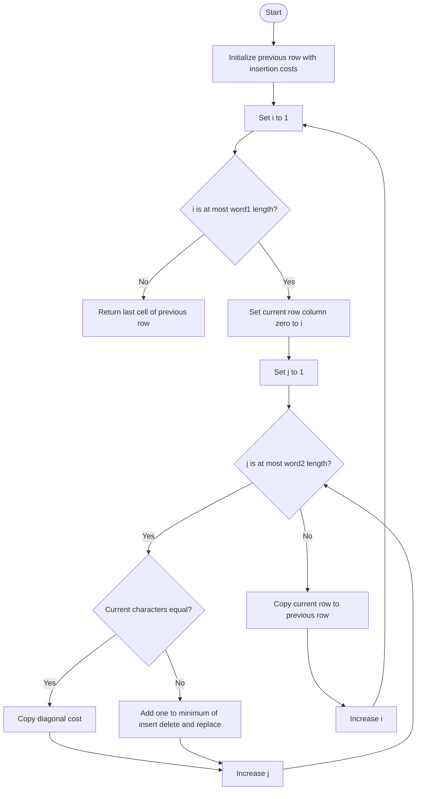

# 72. Edit Distance

## 1. Problem Understanding

`word1` ला `word2` मध्ये बदलण्यासाठी लागणाऱ्या minimum operations ची संख्या शोधा. Allowed operations:

1. एक character insert करणे.
2. एक character delete करणे.
3. एक character replace करणे.
   प्रत्येक operation ची cost `1`. दोन्ही words रिकामे असू शकतात; एका रिकाम्या string ला दुसऱ्यात बदलण्यासाठी त्या string मधील सर्व characters insert/delete करावे लागतात.
   **Constraints:** दोन्ही words मध्ये lowercase English letters असतात आणि प्रत्येकाची length `500` पर्यंत; quadratic `O(mn)` DP या मर्यादेसाठी योग्य आहे.

## 2. Example Understanding

### Example 1

```text
word1 = "horse", word2 = "ros"
Output: 3
```

एक valid sequence: `horse → rorse` (पहिला character replace), `rorse → rose` (एक `r` delete), `rose → ros` (`e` delete). एकूण 3 operations.

### Example 2

```text
word1 = "intention", word2 = "execution"
Output: 5
```

योग्य insert/delete/replace क्रमाने 5 operations पुरतात; DP सर्व शक्य operation sequences मधून minimum शोधते.

### Edge cases

- `word1=""`, `word2="abc"` → `3` inserts.
- `word1="abc"`, `word2=""` → `3` deletes.
- दोन्ही सारखे → `0`.

## 3. Problem Identification

दोन strings मधील minimum insert/delete/replace operations हा **Edit Distance / Levenshtein DP** चा संकेत आहे. State दोन prefixes/suffixes वर असतो; mismatch आल्यास तीन operation choices compare करायचे.
स्वतःला विचारा:

1. शेवटचे characters समान असतील तर operation करणे आवश्यक आहे का? नाही; दोन्ही एकत्र consume करा.
2. वेगळे असतील तर insert/delete/replace पैकी काय शक्य? तिन्ही.
3. प्रत्येक operation समान cost ची आहे का? होय; प्रत्येक transition मध्ये `1`.
4. Prefix रिकामा असेल तर answer काय? दुसऱ्या prefix ची length.

### Pattern Recognition Cheat Sheet

| Clue in Question                    | Possible Pattern             | Why?                                                 |
| ----------------------------------- | ---------------------------- | ---------------------------------------------------- |
| Minimum changes between two strings | Edit Distance DP             | Prefix pairs वर optimal subproblems                  |
| Insert/delete/replace operations    | 2D DP with three transitions | Mismatch वर operation choices                        |
| Transform one string into another   | Prefix alignment             | दोन्ही strings मधील consumed characters track करायचे |
| Same characters align               | Diagonal transition          | Match ला operation cost नाही                         |
| Empty prefix                        | Base row/column              | उरलेले सर्व characters insert/delete होतात           |

Longest Common Subsequence, one-string insertion/deletion, आणि sequence alignment हे related patterns आहेत.

## 4. Different Approaches

### A. Plain recursion — brute force

`solve(i,j)` म्हणजे `word1` चे पहिले `i` characters `word2` च्या पहिल्या `j` characters मध्ये बदलण्याची minimum cost. एखादा prefix रिकामा असेल तर उरलेली length cost. Characters समान असतील तर diagonal state; mismatch असल्यास insert/delete/replace तिन्ही recurse करून minimum + 1.

- Time: worst-case exponential; mismatch वर तीन branches.
- Space: `O(m+n)` recursion depth.
- Pros: operation meaning स्पष्ट.
- Cons: repeated states मुळे मोठ्या input वर slow.

### B. Memoization — top-down

प्रत्येक `(i,j)` result `dp` मध्ये cache करा.

- Time: `O(mn)`, space: `O(mn)` table + `O(m+n)` recursion stack.
- Pros: recursion structure राखून repeated computation काढते.
- Cons: call stack आणि table दोन्ही.

### C. Tabulation — bottom-up

`dp[i][j]` = पहिल्या `i` characters ला पहिल्या `j` characters मध्ये बदलण्याची minimum cost. `dp[i][0]=i`, `dp[0][j]=j`; recurrence भरून `dp[m][n]` return करा.

- Time: `O(mn)`, space: `O(mn)`.
- Pros: base cases आणि तीन operations स्पष्ट.
- Cons: full matrix memory.

### D. Space-optimized DP

प्रत्येक row ला मागील row आणि current row चा डावा cell लागतो. `prev` आणि `curr` arrays वापरून matrix memory कमी करता येते.

- Time: `O(mn)`, space: `O(n)` (`n=word2.length()`; code dimensions swap करत नाही).
- Pros: फक्त distance हवी असल्यास कमी memory.
- Cons: full table नसल्याने exact edit sequence reconstruct करणे अवघड.
- Recommended: length-only answer साठी `minDistanceOptimized`.
  | Approach | Time | Space | Pros | Cons |
  |---|---:|---:|---|---|
  | Plain recursion | Exponential worst case | `O(m+n)` stack | Operation choices intuitive | Repeated work |
  | Memoization | `O(mn)` | `O(mn)` + stack | Top-down DP | Recursion overhead |
  | Tabulation | `O(mn)` | `O(mn)` | Full state table | Memory usage |
  | Two-row DP | `O(mn)` | `O(n)` | Space efficient | Edit operations reconstruct करणे कठीण |
  Brute force correct पण inefficient. Mismatch वर फक्त एक operation निवडणारा greedy **योग्य नाही**; local choice चा परिणाम उरलेल्या suffix वर अवलंबून असतो.

## 5. Flowchart



Match असेल तर cost वाढत नाही. Mismatch असेल तर तीनपैकी कमी previous cost निवडून एक operation जोडतो. प्रत्येक row `word1` चा पुढचा character consume करते.

## 6. Algorithm / Intuition

**Key observation:** शेवटचे characters match असतील तर त्यांना बदलण्याची गरज नाही; mismatch असल्यास optimal solution मध्ये insert, delete किंवा replace यापैकी एक operation शेवटी लागू शकतो.

1. `prev[j]=j`: रिकाम्या `word1` पासून `j` characters तयार करण्यासाठी `j` inserts.
2. प्रत्येक `i` साठी `curr[0]=i`: `i` characters रिकाम्या target मध्ये बदलण्यासाठी `i` deletes.
3. Characters समान: `curr[j]=prev[j-1]`.
4. वेगळे: `1 + min(curr[j-1], prev[j], prev[j-1])`.
5. `curr`/`prev` shift करून शेवटचा cell return करा.
   Mismatch recurrence मध्ये `curr[j-1]` = insert, `prev[j]` = delete, `prev[j-1]` = replace.

## 7. Code Explanation

`solveRec` आणि `solveMemo` prefix lengths `i,j` वापरतात, म्हणून character compare `s1[i-1]` व `s2[j-1]`. `i==0` किंवा `j==0` base case दुसरी prefix length return करतो.
`minDistanceTabulation` पूर्ण `(m+1)×(n+1)` matrix भरते. `minDistanceOptimized` पहिली row `prev` मध्ये initialize करते, प्रत्येक `i` साठी `curr[0]=i`, आणि mismatch वर तीन operation costs मधील minimum + 1 घेतो.
**Submission note:** LeetCode method नाव `minDistance` आहे; file मध्ये तुलना methods व local `main` आहेत. Judge मध्ये हवा तो method signature expose/rename करावा. दिलेल्या recurrence मध्ये logical bug दिसत नाही.

## 8. Dry Run

`word1="horse"`, `word2="ros"`. Row prefix `word1`; column prefix `word2`.
| Prefix of `word1` \ Prefix of `word2` | `""` | `r` | `ro` | `ros` |
|---|---:|---:|---:|---:|
| `""` | 0 | 1 | 2 | 3 |
| `h` | 1 | 1 | 2 | 3 |
| `ho` | 2 | 2 | 1 | 2 |
| `hor` | 3 | 2 | 2 | 2 |
| `hors` | 4 | 3 | 3 | 2 |
| `horse` | 5 | 4 | 4 | 3 |
| Step | Variables | Condition | Action | Result |
|---:|---|---|---|---|
| 1 | `i=1,j=1`: `h`,`r` | Mismatch | `1 + min(insert=1, delete=1, replace=0)` | `dp[1][1]=1` |
| 2 | `i=2,j=2`: `o`,`o` | Match | Copy diagonal `dp[1][1]` | `dp[2][2]=1` |
| 3 | `i=3,j=1`: `r`,`r` | Match | Copy diagonal `dp[2][0]` | `dp[3][1]=2` |
| 4 | `i=5,j=3`: `e`,`s` | Mismatch | `1 + min(insert=2, delete=2, replace=3)` | `dp[5][3]=3` |
Return `3`.

## 9. Complexity Analysis

`m=word1.length`, `n=word2.length`. प्रत्येक DP state एकदा भरतो; states `m*n`: **`O(mn)` time**. Memoization/table: **`O(mn)` space**, plus recursion stack `O(m+n)`. Space-optimized code मध्ये दोन `n+1` arrays: **`O(n)` space**.
Quadratic time LeetCode constraints साठी standard आहे. जर फक्त threshold `k` च्या आत distance आहे का विचारले असेल, banded DP सारखी specialized optimization करता येते; सामान्य exact answer साठी दिलेली recurrence योग्य.

## 10. Why This Solution Works

`dp[i][j]` हे prefixes मधील minimum edit count आहे. Empty-prefix base cases थेट आवश्यक insertions/deletions मोजतात. शेवटचे characters समान असतील तर match केल्याने अतिरिक्त operation लागत नाही आणि shorter prefixes चा optimum वापरता येतो. Mismatch असेल तर कोणत्याही valid edit sequence चा शेवट insert, delete किंवा replace पैकी एका action ने मांडता येतो; त्या तिन्ही predecessor states तपासून minimum घेतल्याने सर्वोत्तम sequence मिळते. Prefix lengths वाढत जातात, म्हणून सर्व subproblems finite order मध्ये solve होतात.

## 11. Common Mistakes & Interview Traps

- Insert/delete direction गोंधळणे: `word1 → word2` मध्ये `curr[j-1]` हा target चा एक character insert करतो.
- Match असताना `+1` लावणे; समान character बदलण्याची गरज नाही.
- Mismatch वर तीन operations पैकी एखादी branch विसरणे.
- Empty-string base row/column चुकीची initialize करणे.
- Prefix length `i,j` वापरून `word[i]` access करणे; योग्य index `i-1`.
- Space optimization मध्ये current row चा डावा cell व previous row चे cells योग्य ठेवणे.
- Follow-up: exact edits/operation sequence हवी असल्यास full table आणि traceback/predecessor decisions ठेवा.
- Strings ची length खूप वेगळी असेल आणि फक्त threshold हवा असेल तर banding विचारात घ्या.

## 12. Revision Notes (Quick Recall)

- **Pattern:** Two-string edit-distance DP.
- **Clues:** minimum insert/delete/replace operations to transform one string.
- **Intuition:** match → diagonal; mismatch → `1 + min(insert, delete, replace)`.
- **Base:** empty prefix ते length `k` prefix = `k` operations.
- **Complexity:** `O(mn)` time; full table `O(mn)`, two rows `O(n)`.
- **Mistakes:** operation direction, match cost, `i-1/j-1` indexing.
- **Takeaway:** String transformation problems मध्ये prefixes align करून operation states compare करा.

## 13. Similar Problem Recognition

LCS मध्ये mismatch वर skip options चा maximum; Edit Distance मध्ये operations चा minimum cost. Insert/Delete Distance (replace नसताना) LCS-शी संबंधित आहे: `m+n-2*LCS`. Weighted edit costs असतील तर recurrence तोच, पण insert/delete/replace साठी वेगवेगळे costs जोडावे लागतात. Actual transformation हवी असल्यास DP table वरून minimum predecessor मागे trace करा.

## 14. Final Self-Assessment

1. `dp[i][0]=i` का असते?
2. Characters equal असताना diagonal state कसा मदत करतो?
3. Mismatch recurrence मधील तीन predecessor cells कोणते operation दर्शवतात?
4. दोन-row optimization मध्ये space `O(n)` का होते?
5. `word1` मधून `word2` कडे insert operation कोणता character आणि कुठून घेतो?
