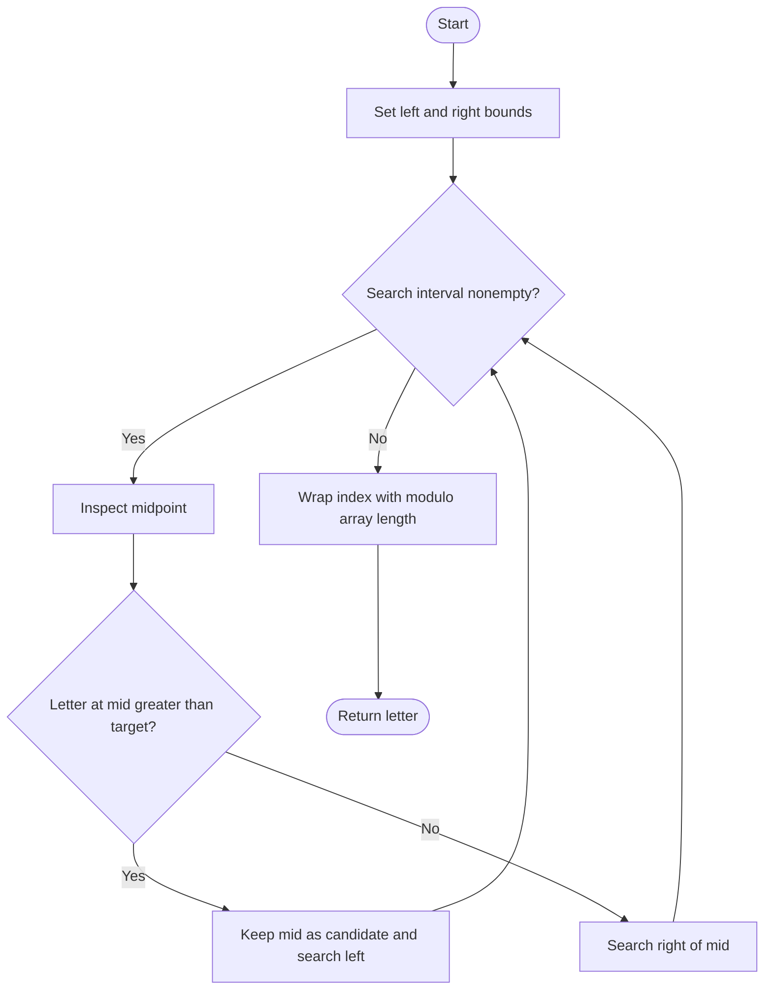

# 744. Find Smallest Letter Greater Than Target

Source: `744.cpp`; manual binary search, linear scan, and `upper_bound` variants.

## 1. Understanding

> **मराठी:** प्रश्नात काय दिले आहे आणि नेमके काय शोधायचे आहे, हे आधी स्पष्ट करा.
> Given sorted letters, return the smallest letter strictly greater than target. If none exists, wrap to the first letter.

## 2. Worked examples and edges

> **मराठी:** प्रश्नात काय दिले आहे आणि नेमके काय शोधायचे आहे, हे आधी स्पष्ट करा.
> `['c','f','j']`, target `'c'` → `'f'` (strictly greater). Target `'z'` wraps to `'c'`. Duplicates are fine; singleton returns its only letter. Input must be nonempty and sorted.

## 3. Pattern identification + cheat sheet

> **मराठी:** या clues मुळे योग्य pattern ओळखता येतो; constraints आणि relations नीट तपासा.
> Need first element `> target`, i.e. upper bound, plus circular wrap.
> | Need | Tool/pattern |
> |---|---|
> | First value strictly greater | Upper bound |
> | Sorted array | Binary search |
> | No match | Wrap to index zero |

## 4. Approaches

> **मराठी:** सोप्या उपायापासून सुरुवात करा आणि constraints नुसार योग्य optimization निवडा.

- **Linear scan (`nextGreatestLetter_Linear`) — simplest, `O(n)`.**
- **Manual binary search — used, `O(log n)` and optimal for sorted input.**
- **STL `upper_bound` — concise `O(log n)` alternative.**
- Lower bound is wrong when target itself is present; strict greater means skip equal values.

## 5. Flowchart

> **मराठी:** Flowchart मधील decision, loop आणि termination condition क्रमाने समजून घ्या.

Binary search insertion point is the first index satisfying `letter > target`.

## 6. Algorithm and intuition

> **मराठी:** मुख्य observation समजल्यावर algorithm चे steps लक्षात ठेवणे सोपे होते.
> Use upper-bound search: if `letters[mid] <= target`, move `left=mid+1`; otherwise move `right=mid-1`. At termination `left` is the answer index, or `n` if it wraps; source uses `left % n`.

## 7. Code explanation

> **मराठी:** Code मधील variable आणि condition यांचा algorithm मधील उद्देश समजून घ्या.
> `nextGreatestLetter_BinarySearch` returns `letters[left % letters.size()]`. The linear version returns on the first strict match, else index 0. STL variant checks whether `upper_bound` reached end.

## 8. Dry run

> **मराठी:** प्रत्येक महत्त्वाच्या step नंतर variable ची value trace करा.
> | `letters` | target | Search outcome | answer |
> |---|---|---|---|
> | `c,f,j` | `c` | equal `c` skipped; first greater index 1 | `f` |
> | `c,f,j` | `z` | insertion point `3` | `c` |

## 9. Complexity

> **मराठी:** Input size आणि प्रत्येक operation कितीदा चालतो यावरून complexity ठरवा.
> Binary/STL: `O(log n)` time, `O(1)` extra space. Linear: `O(n)` time, `O(1)` space.

## 10. Correctness

> **मराठी:** Invariant किंवा तर्क वापरून algorithm योग्य उत्तर देतो हे समजून घ्या.
> At each step, the discarded half cannot contain the first letter greater than target: when middle is `<= target`, all indices through middle fail; otherwise middle and later may qualify. The final insertion index is the first qualifying index, and modulo handles the no-match case.

## 11. Mistakes / interview traps

> **मराठी:** Boundary, duplicate आणि off-by-one cases स्वतंत्रपणे तपासा.

- Condition is `>` not `>=`.
- Wrap when all letters are `<= target`.
- Duplicates do not change the upper-bound logic.
- The code assumes `letters` is nonempty.

## 12. Quick revision

Upper bound: `<= target` → right; `> target` → left. Return `letters[left % n]`.
Target equal असेल तरी पुढचा strictly greater अक्षर हवा.

## 13. Related problems / variations

> **मराठी:** प्रश्नात काय दिले आहे आणि नेमके काय शोधायचे आहे, हे आधी स्पष्ट करा.
> Lower Bound; Search Insert Position; first element greater than or equal to target; circular next-greater query.

## 14. Self-assessment

> **मराठी:** उत्तर न पाहता प्रश्न सोडवा आणि तुमच्या निवडीचे कारण सांगा.

1. Why does equality move the left boundary?
2. What index does upper bound return if every letter qualifies?
3. Why is modulo safe under the input constraints?
4. How does `upper_bound` differ from `lower_bound`?
