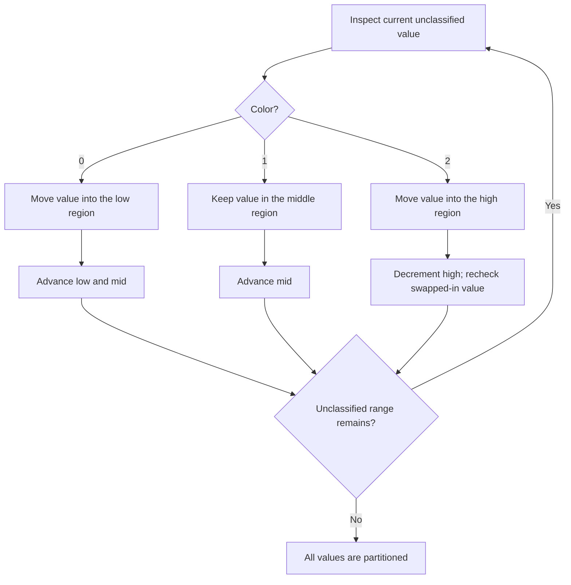

# Sort Colors — LeetCode 75

## Problem and judge interface

`void sortColors(vector<int>& nums)`; reorder an array of 0, 1, and 2 in-place. The source provides pairwise-exchange, counting, and two Dutch National Flag methods.

## Identification evidence

The code implements the three-color counting and Dutch National Flag partition required by problem 75.

## Main flow

```mermaid
flowchart TD
 A([Start]) --> B[Set low=mid=0 and high=n-1]
 B --> C{mid <= high?}
 C -- No --> H([Array is partitioned])
 C -- Yes --> D{Current value nums[mid]}
 D -- 0 --> E[Swap with low; increment low and mid]
 D -- 1 --> F[Increment mid]
 D -- 2 --> G[Swap with high; decrement high and recheck mid]
 E --> C
 F --> C
 G --> C
```
## Important branch / loop


## Core logic and invariants

The first method, named Bubble in the source, uses nested pairwise exchanges. Counting counts each color then overwrites the array. DNF maintains low, mid and high boundaries: zeros before low, ones in [low,mid), unknowns in [mid,high], twos after high. After swapping a 2, mid is rechecked.

## Complexity

Bubble O(n^2); counting and DNF O(n) time. Extra space O(1).

## Comparison and optimization

The source methods are named `sortColorsBubble`, `sortColorsCounting`, `sortColorsDutchFlag1`, and `sortColorsDutchFlag2`; adapt the chosen one to `sortColors`. DNF is one pass and constant space; counting is two passes. The method named Bubble is an inefficient quadratic comparison baseline.

## Compile and run

The `.cpp` is the original standalone source, including its local `main()` demonstration where present. Compile and run from the repository root with a C++17 compiler:

```text
g++ -std=c++17 LeetCode\75\75.cpp -o solution.exe
.\solution.exe
```

For LeetCode, adapt the implementation to the required class/method signature and omit the local `main()` and demonstration helpers; use the judge-provided node types. Notes above identify method-name or behavior differences. The moved source bytes have not been edited.


