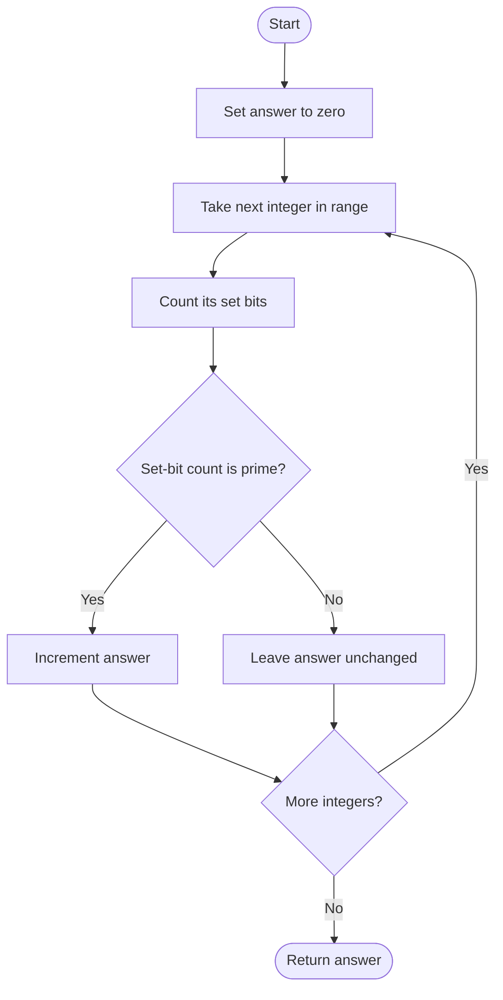

# 762. Prime Number of Set Bits in Binary Representation

Source: `762.cpp`; three variants: trial division, Kernighan + prime set, and bitmask.

## 1. Understanding

> **मराठी:** प्रश्नात काय दिले आहे आणि नेमके काय शोधायचे आहे, हे आधी स्पष्ट करा.
> Count integers in inclusive `[left,right]` whose binary representation has a prime number of `1` bits.

## 2. Worked examples and edges

> **मराठी:** प्रश्नात काय दिले आहे आणि नेमके काय शोधायचे आहे, हे आधी स्पष्ट करा.
> `6` is `110`, with 2 set bits (prime), so it qualifies. `8` is `1000`, one set bit, so not. A count of 0 or 1 is not prime.

## 3. Pattern identification + cheat sheet

> **मराठी:** या clues मुळे योग्य pattern ओळखता येतो; constraints आणि relations नीट तपासा.
> Combine bit counting with a tiny bounded primality test.
> | Subtask | Pattern |
> |---|---|
> | Count 1 bits | `popcount` / Kernighan |
> | Test count primality | Trial division / small lookup |
> | Count lies in small range | Prime bitmask |

## 4. Approaches

> **मराठी:** सोप्या उपायापासून सुरुवात करा आणि constraints नुसार योग्य optimization निवडा.

- **`approach1`:** builtin popcount + trial division; correct, tiny bounded count makes it practical.
- **`approach2`:** Kernighan loop + prime set; average `O(B)` per value, stops once all set bits cleared.
- **`approach3`:** builtin popcount + prime mask; compact and used as a constant-time prime test.
- Avoid testing primality of the original integer; only its set-bit count matters.

## 5. Flowchart

> **मराठी:** Flowchart मधील decision, loop आणि termination condition क्रमाने समजून घ्या.

Prime counts fit in the small range of possible bit positions.

## 6. Algorithm and intuition

> **मराठी:** मुख्य observation समजल्यावर algorithm चे steps लक्षात ठेवणे सोपे होते.
> For each value, get its Hamming weight. Check membership in `{2,3,5,7,11,13,17,19,23,29,31}`. In `approach3`, bit `p` of `primeMask` is set iff `p` is prime.

## 7. Code explanation

> **मराठी:** Code मधील variable आणि condition यांचा algorithm मधील उद्देश समजून घ्या.
> `isPrime` trial-divides through `sqrt(n)`. `countSetBits` repeatedly applies `n &= n-1`. The third method uses `__builtin_popcount` and shifts the precomputed mask. Main runs all three for comparison.

## 8. Dry run

> **मराठी:** प्रत्येक महत्त्वाच्या step नंतर variable ची value trace करा.
> | Value | Binary | Set bits | Prime? | Count |
> |---:|---|---:|---|---:|
> | 6 | `110` | 2 | yes | 1 |
> | 7 | `111` | 3 | yes | 2 |
> | 8 | `1000` | 1 | no | 2 |

## 9. Complexity

> **मराठी:** Input size आणि प्रत्येक operation कितीदा चालतो यावरून complexity ठरवा.
> For range width `W` and integer bit width `B`: `O(W·B)` worst-case time with Kernighan/trial check, `O(1)` extra space. Under fixed 32-bit constraints it is linear in `W`.

## 10. Correctness

> **मराठी:** Invariant किंवा तर्क वापरून algorithm योग्य उत्तर देतो हे समजून घ्या.
> Each value is counted exactly once after its set bits are counted. The prime lookup/mask (or trial division) accepts exactly prime bit counts, so the accumulator equals the requested number of qualifying values.

## 11. Mistakes / interview traps

> **मराठी:** Boundary, duplicate आणि off-by-one cases स्वतंत्रपणे तपासा.

- 0 and 1 are not prime.
- Range endpoints are inclusive.
- In the mask, bit position equals the set-bit count.
- Signed/negative input behavior differs; the original problem uses positive values.

## 12. Quick revision

Iterate range → popcount → prime test over possible bit counts → increment.
Prime test मूळ number वर नाही, तर set-bit count वर करा.

## 13. Related problems / variations

> **मराठी:** प्रश्नात काय दिले आहे आणि नेमके काय शोधायचे आहे, हे आधी स्पष्ट करा.
> Number of 1 Bits; Counting Bits; Hamming distance; range counts by popcount.

## 14. Self-assessment

> **मराठी:** उत्तर न पाहता प्रश्न सोडवा आणि तुमच्या निवडीचे कारण सांगा.

1. Why can prime candidates be precomputed?
2. How does `n &= n-1` remove one set bit?
3. What does bit `p` of the prime mask encode?
4. How does complexity change if integers have arbitrary width?
