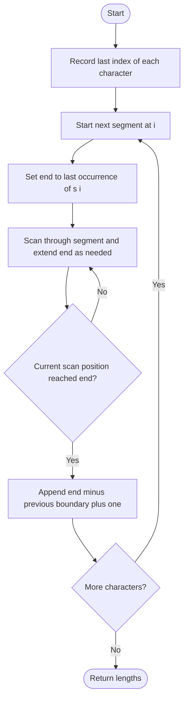

# 763. Partition Labels

Source: `763.cpp`; `partitionLabels(string s)`.

## 1. Understanding

> **मराठी:** प्रश्नात काय दिले आहे आणि नेमके काय शोधायचे आहे, हे आधी स्पष्ट करा.
> Split a string into as many contiguous parts as possible so each letter appears in at most one part. Return each part's length.

## 2. Worked examples and edges

> **मराठी:** प्रश्नात काय दिले आहे आणि नेमके काय शोधायचे आहे, हे आधी स्पष्ट करा.
> For `"ababcbacadefegdehijhklij"`, result is `[9,7,8]`. A single repeated character, `"aaaa"`, gives `[4]`; empty input returns an empty vector.

## 3. Pattern identification + cheat sheet

> **मराठी:** या clues मुळे योग्य pattern ओळखता येतो; constraints आणि relations नीट तपासा.
> An interval must extend through the last occurrence of every character it contains.
> | Clue | Pattern |
> |---|---|
> | Need all occurrences in same segment | Last-occurrence map |
> | Segment end can expand while scanning | Greedy interval merging |
> | Return segment sizes | Boundary difference |

## 4. Approaches

> **मराठी:** सोप्या उपायापासून सुरुवात करा आणि constraints नुसार योग्य optimization निवडा.

- **Try every possible partition — exponential and unnecessary.**
- **Greedy last-occurrence sweep — used:** extend current end to cover each character's final index; `O(n)`.
- A two-pass array of last positions for lowercase letters is also `O(n)` and avoids hashing.

## 5. Flowchart

> **मराठी:** Flowchart मधील decision, loop आणि termination condition क्रमाने समजून घ्या.

The segment closes only after every character in it has had its last appearance included.

## 6. Algorithm and intuition

> **मराठी:** मुख्य observation समजल्यावर algorithm चे steps लक्षात ठेवणे सोपे होते.
> Precompute each character's final index. At a segment start, initialize `end` to that character's last index. Scan through the growing interval, raising `end` whenever a newly encountered character reaches farther. Close when scan reaches `end`.

## 7. Code explanation

> **मराठी:** Code मधील variable आणि condition यांचा algorithm मधील उद्देश समजून घ्या.
> `ump` stores last positions. `end` is the current inclusive segment endpoint; inner loop expands it. `preEnd` is one past the previous segment's endpoint, so length is `end-preEnd+1`. The loop sets `i=end` before its increment.

## 8. Dry run

> **मराठी:** प्रत्येक महत्त्वाच्या step नंतर variable ची value trace करा.
> | Scanned chars | Last positions force end to | Segment |
> |---|---:|---|
> | `ababcbaca` | 8 | `[0..8]`, length 9 |
> | `defegde` | 15 | `[9..15]`, length 7 |
> | `hijhklij` | 23 | `[16..23]`, length 8 |

## 9. Complexity

> **मराठी:** Input size आणि प्रत्येक operation कितीदा चालतो यावरून complexity ठरवा.
> Expected `O(n)` time and `O(σ)` space for distinct characters, where `σ` is alphabet size. The source uses an unordered map; for the fixed 26-letter alphabet this is `O(1)` auxiliary space.

## 10. Correctness

> **मराठी:** Invariant किंवा तर्क वापरून algorithm योग्य उत्तर देतो हे समजून घ्या.
> Any valid partition containing a character must include its last occurrence. The greedy endpoint is repeatedly expanded to include the last occurrence of every character encountered, so the closed interval is valid. Closing at the earliest such endpoint is safe and maximizes the number of segments; repeating gives the optimal partition.

## 11. Mistakes / interview traps

> **मराठी:** Boundary, duplicate आणि off-by-one cases स्वतंत्रपणे तपासा.

- Use last occurrence, not first.
- Inner scan must use the expanding endpoint.
- Segment length is inclusive (`end-start+1`).
- For lowercase-only constraints, fixed array can replace map; current code accepts generic char keys.

## 12. Quick revision

Last index map → grow current interval to cover every encountered character's last index → close and record length.
एका partition मधला अक्षर पुन्हा पुढच्या partition मध्ये येऊ नये.

## 13. Related problems / variations

> **मराठी:** प्रश्नात काय दिले आहे आणि नेमके काय शोधायचे आहे, हे आधी स्पष्ट करा.
> Merge Intervals; Minimum Number of Arrows to Burst Balloons; string partitioning with character-frequency constraints.

## 14. Self-assessment

> **मराठी:** उत्तर न पाहता प्रश्न सोडवा आणि तुमच्या निवडीचे कारण सांगा.

1. Why must a segment include the last occurrence of each character?
2. Why can the endpoint only move right?
3. What makes closing at the earliest valid endpoint optimal?
4. How would a fixed alphabet array change space/use?
