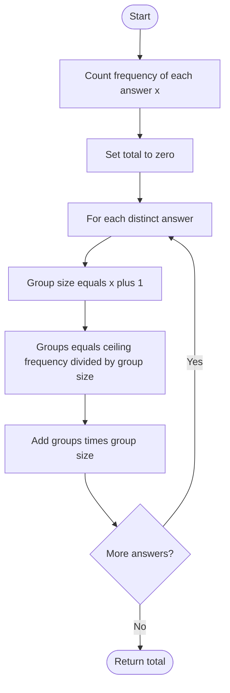

# 781. Rabbits in Forest

Source: `781.cpp`; `numRabbits(vector<int>& answers)`.

## 1. Understanding

> **मराठी:** प्रश्नात काय दिले आहे आणि नेमके काय शोधायचे आहे, हे आधी स्पष्ट करा.
> Each rabbit says how many other rabbits share its color. Find the minimum total rabbit count consistent with all answers.

## 2. Worked examples and edges

> **मराठी:** प्रश्नात काय दिले आहे आणि नेमके काय शोधायचे आहे, हे आधी स्पष्ट करा.
> `[1,1,2]`: answer 1 implies a color group of 2; answer 2 implies a group of 3; total 5. Empty answers return 0. If `x=0`, each report is a singleton color.

## 3. Pattern identification + cheat sheet

> **मराठी:** या clues मुळे योग्य pattern ओळखता येतो; constraints आणि relations नीट तपासा.
> Identical reports imply bounded group sizes; group observed counts with ceiling division.
> | Clue | Pattern |
> |---|---|
> | Report says “others” | Add one to get group capacity |
> | More reports than one group fits | Ceiling number of groups |
> | Minimize unseen entities | Greedy grouping by report value |

## 4. Approaches

> **मराठी:** सोप्या उपायापासून सुरुवात करा आणि constraints नुसार योग्य optimization निवडा.

- **Treat every report as a distinct color — correct but overcounts.**
- **Frequency map + group rounding — used and optimal:** each answer value is independent; `O(n)` average.
- Avoid pairing different answers together: one color group has one fixed size and therefore one fixed answer.

## 5. Flowchart

> **मराठी:** Flowchart मधील decision, loop आणि termination condition क्रमाने समजून घ्या.

Incomplete groups still require the full group size.

## 6. Algorithm and intuition

> **मराठी:** मुख्य observation समजल्यावर algorithm चे steps लक्षात ठेवणे सोपे होते.
> For answer `x`, each color group contains `x+1` rabbits. If `f` rabbits report `x`, need `ceil(f/(x+1))` groups, contributing that many complete groups. Sum independently for each answer.

## 7. Code explanation

> **मराठी:** Code मधील variable आणि condition यांचा algorithm मधील उद्देश समजून घ्या.
> The source stores `AnswerFreq[x]`, computes `ColorGroupSize=x+1`, uses floating `ceil(Freq/size)`, and adds `groups*size`. Integer ceiling formula is `(f+x)/(x+1)`.

## 8. Dry run

> **मराठी:** प्रत्येक महत्त्वाच्या step नंतर variable ची value trace करा.
> | Answer `x` | Frequency | Group size | Groups | Rabbits |
> |---:|---:|---:|---:|---:|
> | 1 | 2 | 2 | 1 | 2 |
> | 2 | 1 | 3 | 1 | 3 |
> | total | — | — | — | 5 |

## 9. Complexity

> **मराठी:** Input size आणि प्रत्येक operation कितीदा चालतो यावरून complexity ठरवा.
> Average `O(n)` time and `O(u)` space, where `u` is the number of distinct answers.

## 10. Correctness

> **मराठी:** Invariant किंवा तर्क वापरून algorithm योग्य उत्तर देतो हे समजून घ्या.
> An answer `x` partitions rabbits of that report into groups of exactly `x+1`; no such group can contain more or fewer reporters without contradicting their answer. Thus at least `ceil(f/(x+1))` groups are needed, and that many full groups suffice. Different answers require distinct colors, so summing these minima is optimal.

## 11. Mistakes / interview traps

> **मराठी:** Boundary, duplicate आणि off-by-one cases स्वतंत्रपणे तपासा.

- “x other rabbits” means total group size `x+1`.
- Round groups upward, not down.
- A partial final group still contributes all `x+1` rabbits.
- Avoid floating point with the integer ceiling formula if desired.

## 12. Quick revision

For each answer `x`, `g=x+1`, `groups=ceil(freq/g)`, add `groups*g`.
शेवटचा group अपूर्ण असला तरी पूर्ण group size मोजायचा.

## 13. Related problems / variations

> **मराठी:** प्रश्नात काय दिले आहे आणि नेमके काय शोधायचे आहे, हे आधी स्पष्ट करा.
> Minimum groups with fixed capacity; car pooling/group-size counting; frequency bucket rounding.

## 14. Self-assessment

> **मराठी:** उत्तर न पाहता प्रश्न सोडवा आणि तुमच्या निवडीचे कारण सांगा.

1. Why is group size `x+1`, not `x`?
2. Why round the number of groups upward?
3. Why cannot answer-1 and answer-2 rabbits share a group?
4. What integer formula replaces `ceil`?
