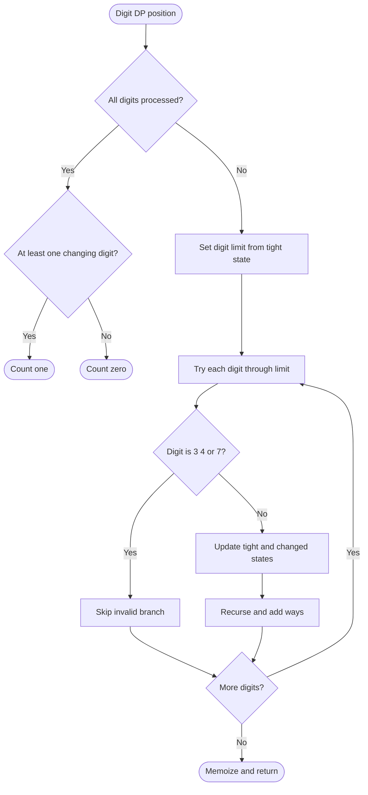

# 788. Rotated Digits

Source: `788.cpp`; brute force, digit classification DP, and digit-DP variants.

## 1. Understanding

> **मराठी:** प्रश्नात काय दिले आहे आणि नेमके काय शोधायचे आहे, हे आधी स्पष्ट करा.
> Count numbers from 1 through `n` that remain valid after rotating every decimal digit 180 degrees and are changed to a different number. Digits 3, 4, 7 invalidate; 2, 5, 6, 9 change; 0, 1, 8 stay fixed.

## 2. Worked examples and edges

> **मराठी:** प्रश्नात काय दिले आहे आणि नेमके काय शोधायचे आहे, हे आधी स्पष्ट करा.
> `2` is good (`2→5`); `11` stays the same, not good; `17` is invalid because 7 has no valid rotation. `n=0` yields zero.

## 3. Pattern identification + cheat sheet

> **मराठी:** या clues मुळे योग्य pattern ओळखता येतो; constraints आणि relations नीट तपासा.
> This is digit classification with a “valid and changed at least once” state; for large bounds use digit DP.
> | Need | Pattern |
> |---|---|
> | Classify whole number | Invalid / same / changed |
> | Count all values up to bound | Digit DP with `tight` |
> | Require at least one changed digit | Boolean state `changed` |

## 4. Approaches

> **मराठी:** सोप्या उपायापासून सुरुवात करा आणि constraints नुसार योग्य optimization निवडा.

- **Brute (`rotatedDigits_Brute`) — clear, `O(n log n)`:** inspect every digit of every number.
- **DP table (`rotatedDigits_DP`) — used, `O(n)` time/space:** derive classification from prefix and final digit.
- **Digit DP (`rotatedDigits_DigitDP`) — scales with digits:** `O(d·10)` states/transitions, `O(d)` memo; best when the numeric bound is huge.

## 5. Flowchart

> **मराठी:** Flowchart मधील decision, loop आणि termination condition क्रमाने समजून घ्या.

Leading zero digits represent shorter numbers; they stay unchanged and never create a false “good” result.

## 6. Algorithm and intuition

> **मराठी:** मुख्य observation समजल्यावर algorithm चे steps लक्षात ठेवणे सोपे होते.
> Each digit is independently either invalid, unchanged, or changed. A number is good iff no digit is invalid and at least one digit changes. Digit DP tracks position, whether the prefix still matches `n`, and whether a change has occurred.

## 7. Code explanation

> **मराठी:** Code मधील variable आणि condition यांचा algorithm मधील उद्देश समजून घ्या.
> `isGood` scans digits. `rotatedDigits_DP` labels each integer as 0 invalid, 1 valid-same, or 2 valid-changed. `digitDP` memoizes `(pos,tight,changed)` and skips invalid digits. `nextTight` remains true only when the chosen digit equals the bound digit.

## 8. Dry run

> **मराठी:** प्रत्येक महत्त्वाच्या step नंतर variable ची value trace करा.
> | Number | Digits classified | Outcome |
> |---:|---|---|
> | 25 | 2 changed, 5 changed | valid and changed → good |
> | 18 | 1 same, 8 same | valid but unchanged → not good |
> | 27 | 2 changed, 7 invalid | invalid → not good |

## 9. Complexity

> **मराठी:** Input size आणि प्रत्येक operation कितीदा चालतो यावरून complexity ठरवा.
> Brute: `O(n·d)` time, `O(d)` temporary scan. Array DP: `O(n)` time/space. Digit DP: `O(d·2·2·10)` time and `O(d·2·2)` memo space.

## 10. Correctness

> **मराठी:** Invariant किंवा तर्क वापरून algorithm योग्य उत्तर देतो हे समजून घ्या.
> The digit classes exactly match the rotation rules. Brute accepts precisely when every digit is valid and at least one changes. The DP variants combine those classifications; digit DP explores every bound-respecting digit choice once per state and accepts only changed terminal paths, so it counts exactly the good values.

## 11. Mistakes / interview traps

> **मराठी:** Boundary, duplicate आणि off-by-one cases स्वतंत्रपणे तपासा.

- Valid-but-unchanged numbers do not count.
- Any one invalid digit makes the whole number invalid.
- Ensure `tight` is not lost when choosing a bound-equal digit.
- The digit DP counts leading-zero representations only as the number zero, which is not good.

## 12. Quick revision

Allowed same `{0,1,8}`, allowed changed `{2,5,6,9}`, forbidden `{3,4,7}`; need valid + changed.
किमान एक digit बदलला पाहिजे, नाहीतर number good नाही.

## 13. Related problems / variations

> **मराठी:** प्रश्नात काय दिले आहे आणि नेमके काय शोधायचे आहे, हे आधी स्पष्ट करा.
> Digit DP counting numbers with forbidden digits; strobogrammatic numbers; count numbers containing at least one special digit.

## 14. Self-assessment

> **मराठी:** उत्तर न पाहता प्रश्न सोडवा आणि तुमच्या निवडीचे कारण सांगा.

1. Why does 11 not count?
2. Which state ensures some digit actually changes?
3. What does `tight` mean?
4. When is digit DP better than scanning all values?
