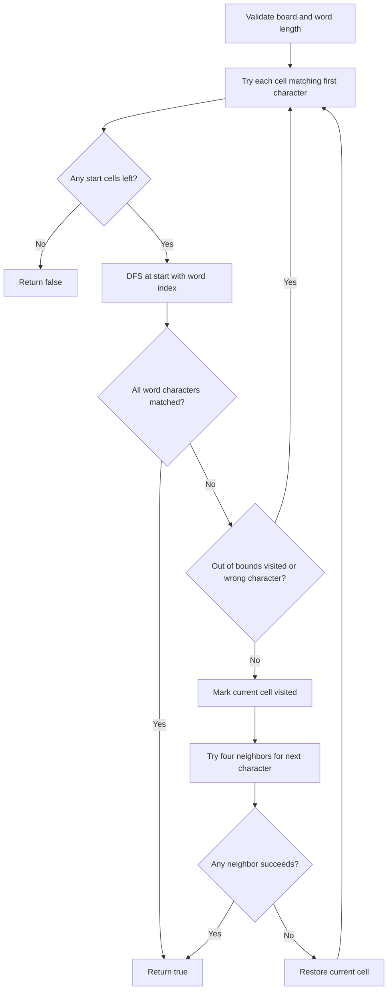

# 79. Word Search

## 1. Problem Understanding

Given a character grid and one word, return true if its letters can be followed through horizontally or vertically adjacent cells. A cell cannot be reused in the same word path. Diagonal moves are not allowed.

## 2. Example Understanding

On the standard board `A B C E / S F C S / A D E E`, `"ABCCED"` is true by following adjacent cells; `"SEE"` is true; `"ABCB"` is false because it would need to reuse a cell. If word length exceeds the number of cells, it is impossible. A one-letter word is found if that character occurs.

## 3. Problem Identification

### Pattern Recognition Cheat Sheet

| Clue in Question                       | Possible Pattern             | Why?                                    |
| -------------------------------------- | ---------------------------- | --------------------------------------- |
| Spell a word through neighboring cells | Grid DFS                     | Each next character must be adjacent    |
| No cell reuse                          | Backtracking / visited state | Path-local constraint                   |
| Return only existence                  | Early exit boolean search    | Stop as soon as one path succeeds       |
| Several possible directions            | Branching search             | Try four neighbors at each matched cell |

Ask: What is the state? It is `(row, column, word index, visited path)`. How do I undo a choice when that branch fails?

## 4. Different Approaches

1. **Brute-force DFS + backtracking (provided):** Start at every matching first character; recursively try all four neighbors, marking/restoring cells. Correct, worst-case exponential.
2. **Pruned DFS (provided):** Reject impossible length, compare character counts, and optionally reverse word to begin at the rarer endpoint. The core search is unchanged; these are heuristics/pruning.
   | Approach | Time | Space | Pros | Cons |
   |---|---:|---:|---|---|
   | Basic DFS | O(RC·4^L) worst case | O(L) stack | Simple and complete | Large branching |
   | Pruned DFS | Same worst case; often faster | O(L)+O(Σ) frequency array | Rejects impossible cases early | Extra checks; heuristics don't alter worst case |
   `R,C` grid dimensions and `L` word length. Frequency check is necessary but not sufficient: adjacency still matters.

## 5. Flowchart

Matched cell temporarily visited mark hoto. Chaar neighbors madhun ek path complete zala tar true; nahi tar cell restore करून दुसरा मार्ग तपासतो.

## 6. Algorithm / Intuition

DFS state includes current cell and next word index. Reject invalid coordinates, reused cells, and mismatched letters. Mark a matching cell, search neighbors, then restore it. Start this search from every cell matching the first character.

## 7. Code Explanation

[`79.cpp`](./79.cpp) defines `dfsBrute` and `dfsOptimized`; both mark a matched board cell with `#` and restore the saved `ch` on return. `existOptimized` rejects words longer than `m*n`, checks board frequency, and may reverse the word to start from a rarer endpoint. Note: its endpoint heuristic compares `freq[word[0]]` and `freq[word.back()]` **after decrementing counts for every word character**; this may choose a less effective direction, but does not affect correctness. For a cleaner heuristic, compare original counts before consuming them. The method handles empty board/word explicitly.

## 8. Dry Run

For a path matching `"AB"`:
| Step | Variables | Condition | Action | Result |
|---|---|---|---|---|
| 1 | Start at cell `A`, `idx=0` | Character matches | Mark `A` visited | Continue |
| 2 | Neighbor `B`, `idx=1` | Character matches | Mark `B` visited | Continue |
| 3 | `idx==word.size()` | All letters used | Return true | Path found |
| 4 | Unwind recursion | Success | Restore `B`, then `A` | Input board unchanged |

## 9. Complexity Analysis

At most `R*C` starting cells and up to four branches per character, giving a loose **O(RC·4^L)** worst-case time. No cell repeats, so recursion depth is at most `min(L,RC)` and auxiliary stack is **O(L)**. Frequency counting is O(RC+L), dominated by search.

## 10. Why This Solution Works

Any valid spelling begins at a cell equal to the first character; the outer loops try all such cells. At each matched character, DFS enumerates every legal next neighbor. The visited mark enforces no reuse, and restoration makes other branches independent. Therefore DFS finds a path iff one exists; the index increases on every successful move, so recursion terminates.

## 11. Common Mistakes & Interview Traps

- Checking `idx==word.size()` before indexing the word.
- Forgetting backtracking restoration on all return paths.
- Marking visited only after recursive calls, allowing cycles.
- Treating diagonal neighbors as valid.
- Frequency counts can reject impossible inputs but cannot prove a path exists.
- Special sentinel `#` assumes board characters are not `#`; use visited matrix for broader alphabets.
- Follow-up: return the actual path or search many words with Trie (Word Search II).

## 12. Revision Notes (Quick Recall)

- **Pattern:** Grid DFS + backtracking.
- **Clues:** Neighbor-constrained sequence, no cell reuse, existence query.
- **Intuition:** Try each start; mark, explore, restore.
- **Complexity:** O(RC·4^L) worst case; O(L) stack.
- **Trap:** Visited status is local to current path, not global.
- **Takeaway:** Backtracking explores alternatives while preserving the original board.

## 13. Similar Problem Recognition

Word Search II adds many words and benefits from a Trie. Maze path problems share grid DFS and visited state. If cells can be reused, remove path-local visited restriction; if shortest path is asked, BFS may be more appropriate.

## 14. Final Self-Assessment

1. Why is one global `visited` array not appropriate across all starts?
2. Why must the board be restored after DFS?
3. Can matching letter frequencies prove the word exists? Why?
4. What bounds the recursion depth?
5. How does Word Search II reduce repeated prefix work?
