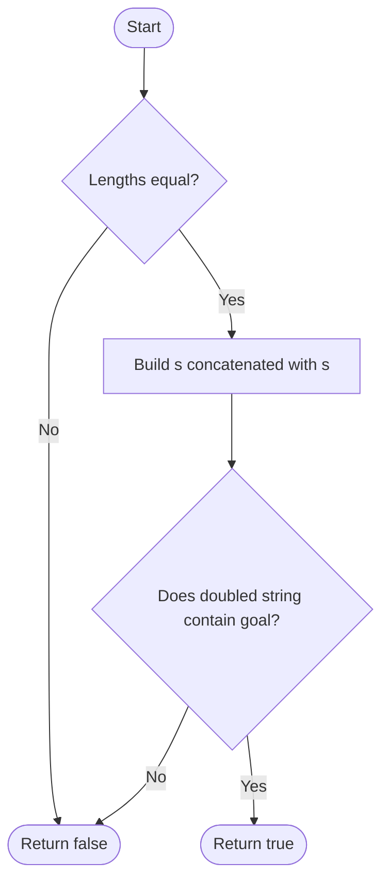

# 796. Rotate String

Source: `796.cpp`; concatenation/search, manual shifts, and deque variants.

## 1. Understanding

> **मराठी:** प्रश्नात काय दिले आहे आणि नेमके काय शोधायचे आहे, हे आधी स्पष्ट करा.
> Return whether `goal` can be obtained by repeatedly rotating `s` left. Rotation preserves length and character order cyclically.

## 2. Worked examples and edges

> **मराठी:** प्रश्नात काय दिले आहे आणि नेमके काय शोधायचे आहे, हे आधी स्पष्ट करा.
> `"abcde" → "cdeab"` is true; `"abcde" → "abced"` is false. Different lengths immediately fail. Empty strings: concatenation variant returns true, but source manual/deque variants return false because they never test the original string; original LeetCode constraints use nonempty strings.

## 3. Pattern identification + cheat sheet

> **मराठी:** या clues मुळे योग्य pattern ओळखता येतो; constraints आणि relations नीट तपासा.
> All rotations are cyclic substrings of `s+s`.
> | Clue | Pattern |
> |---|---|
> | Circular shift matching | Concatenate string with itself |
> | Need exact rotation | Equal lengths + substring search |
> | Compare explicit shifts | Modular indexing / KMP |

## 4. Approaches

> **मराठी:** सोप्या उपायापासून सुरुवात करा आणि constraints नुसार योग्य optimization निवडा.

- **Try every shift (`approach2`) — correct for nonempty input, `O(n²)`.**
- **Deque rotation (`approach3`) — `O(n²)`** because it rebuilds a string each turn; it also misses the initial state for empty input.
- **`s+s` plus `find` (`approach1`) — concise and usually preferred:** first check equal lengths, then search. Worst-case search complexity depends on library algorithm; KMP guarantees `O(n)`.
- Comparing only character frequencies is incorrect; relative order matters.

## 5. Flowchart

> **मराठी:** Flowchart मधील decision, loop आणि termination condition क्रमाने समजून घ्या.

The doubled string contains every cyclic starting position.

## 6. Algorithm and intuition

> **मराठी:** मुख्य observation समजल्यावर algorithm चे steps लक्षात ठेवणे सोपे होते.
> If `goal` is a rotation of `s`, it appears inside `s+s`; matching length rules out a non-rotation substring. Conversely, every length-`n` substring of `s+s` starting before index `n` is a rotation.

## 7. Code explanation

> **मराठी:** Code मधील variable आणि condition यांचा algorithm मधील उद्देश समजून घ्या.
> `approach1` rejects unequal sizes and uses `find`. `approach2` compares modular positions for each shift. `approach3` rotates a deque left and rebuilds a string after each shift. Code caveat: variants 2 and 3 omit testing shift zero for empty input.

## 8. Dry run

> **मराठी:** प्रत्येक महत्त्वाच्या step नंतर variable ची value trace करा.
> | Input | Doubled string | Match? |
> |---|---|---|
> | `s=abcde`, `goal=cdeab` | `abcdeabcde` | yes |
> | `s=abcde`, `goal=abced` | `abcdeabcde` | no |

## 9. Complexity

> **मराठी:** Input size आणि प्रत्येक operation कितीदा चालतो यावरून complexity ठरवा.
> Concatenation uses `O(n)` space; search is commonly near-linear but a portable worst-case guarantee needs KMP (`O(n)` time). Manual and deque variants are `O(n²)` time; deque uses `O(n)` space.

## 10. Correctness

> **मराठी:** Invariant किंवा तर्क वापरून algorithm योग्य उत्तर देतो हे समजून घ्या.
> A rotation starts at some index `k` of `s` and wraps once at most. `s+s` contains the suffix from `k` followed by the needed prefix; equal-length substring matching is therefore equivalent to being a rotation.

## 11. Mistakes / interview traps

> **मराठी:** Boundary, duplicate आणि off-by-one cases स्वतंत्रपणे तपासा.

- Check equal lengths first.
- Empty-string behavior depends on implementation; current manual/deque variants miss it.
- Character multiset equality alone is insufficient.
- `find` complexity is library-dependent; mention KMP for strict guarantees.

## 12. Quick revision

Equal lengths? Then `goal` occurs in `s+s`? If yes, rotation. Original input excludes empty string; source alternatives have that edge discrepancy.
`s+s` मधील length-`n` substring हाच rotation असतो.

## 13. Related problems / variations

> **मराठी:** प्रश्नात काय दिले आहे आणि नेमके काय शोधायचे आहे, हे आधी स्पष्ट करा.
> String Matching; Repeated String Match; KMP; cyclic array rotation.

## 14. Self-assessment

> **मराठी:** उत्तर न पाहता प्रश्न सोडवा आणि तुमच्या निवडीचे कारण सांगा.

1. Why is the doubled string long enough?
2. Why must lengths match?
3. Why do frequency counts not prove rotation?
4. How would KMP make worst-case search linear?
