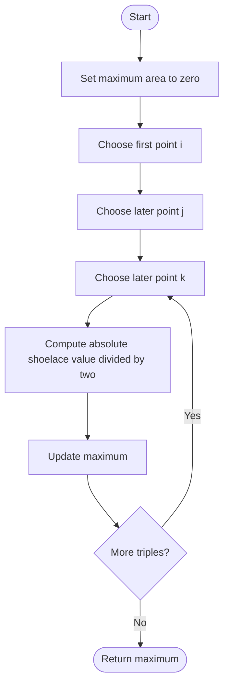

# 812. Largest Triangle Area

Source: `812.cpp`; `largestTriangleArea(vector<vector<int>>& points)`.

## 1. Understanding

> **मराठी:** प्रश्नात काय दिले आहे आणि नेमके काय शोधायचे आहे, हे आधी स्पष्ट करा.
> Choose any three distinct points and return the largest triangle area they form. Collinear points produce area zero.

## 2. Worked examples and edges

> **मराठी:** प्रश्नात काय दिले आहे आणि नेमके काय शोधायचे आहे, हे आधी स्पष्ट करा.
> For `(0,0),(0,1),(1,0)`, area is `1/2`. If all points lie on one line, answer is 0. Fewer than three points also leave the initialized maximum at 0, though normal constraints provide enough points.

## 3. Pattern identification + cheat sheet

> **मराठी:** या clues मुळे योग्य pattern ओळखता येतो; constraints आणि relations नीट तपासा.
> Small point sets and an objective over triples call for exhaustive combination enumeration plus a constant-time geometric formula.
> | Need | Pattern |
> |---|---|
> | Select 3 distinct points | 3 nested loops |
> | Triangle from coordinates | Shoelace / cross product |
> | Maximum over candidates | Running maximum |

## 4. Approaches

> **मराठी:** सोप्या उपायापासून सुरुवात करा आणि constraints नुसार योग्य optimization निवडा.

- **Enumerate all triples — used and appropriate:** `O(n³)` time, `O(1)` extra space.
- **Convex hull + farthest-area techniques — useful for much larger point sets**, but overkill for this problem's constraints.
- A bounding-box area is incorrect because points need not occupy its corners.

## 5. Flowchart

> **मराठी:** Flowchart मधील decision, loop आणि termination condition क्रमाने समजून घ्या.

Index ordering `i<j<k` visits every unordered triple exactly once.

## 6. Algorithm and intuition

> **मराठी:** मुख्य observation समजल्यावर algorithm चे steps लक्षात ठेवणे सोपे होते.
> For points `(x1,y1),(x2,y2),(x3,y3)`, area is `|x1(y2-y3)+x2(y3-y1)+x3(y1-y2)|/2`. Compute this for every triple and retain the largest.

## 7. Code explanation

> **मराठी:** Code मधील variable आणि condition यांचा algorithm मधील उद्देश समजून घ्या.
> Three increasing loops select distinct indices. The source computes the shoelace determinant, multiplies by `0.5`, and updates `area` (`double`).

## 8. Dry run

> **मराठी:** प्रत्येक महत्त्वाच्या step नंतर variable ची value trace करा.
> | Points | Determinant magnitude | Area |
> |---|---:|---:|
> | `(0,0),(0,1),(1,0)` | 1 | 0.5 |
> | `(0,0),(1,1),(2,2)` | 0 | 0 |

## 9. Complexity

> **मराठी:** Input size आणि प्रत्येक operation कितीदा चालतो यावरून complexity ठरवा.
> `O(n³)` time and `O(1)` auxiliary space.

## 10. Correctness

> **मराठी:** Invariant किंवा तर्क वापरून algorithm योग्य उत्तर देतो हे समजून घ्या.
> Every legal triangle corresponds to one unique index triple `i<j<k`, and the loops examine all such triples. The shoelace formula returns each triangle's exact area; taking the maximum therefore returns the largest possible area.

## 11. Mistakes / interview traps

> **मराठी:** Boundary, duplicate आणि off-by-one cases स्वतंत्रपणे तपासा.

- Take absolute value; point order may be clockwise or counterclockwise.
- Divide by 2; determinant alone is doubled area.
- Collinear triples are valid candidates with area zero.
- Current coordinates/constraints keep intermediate `int` products safe; wider types may be needed at larger bounds.

## 12. Quick revision

All index triples → absolute cross/shoelace determinant ÷ 2 → maximum.
Collinear pointsना area zero मिळतो; तरी triple valid candidate आहे.

## 13. Related problems / variations

> **मराठी:** प्रश्नात काय दिले आहे आणि नेमके काय शोधायचे आहे, हे आधी स्पष्ट करा.
> Valid Triangle Number; convex hull; maximum area polygon; cross product orientation.

## 14. Self-assessment

> **मराठी:** उत्तर न पाहता प्रश्न सोडवा आणि तुमच्या निवडीचे कारण सांगा.

1. Why use `i<j<k`?
2. Why absolute value?
3. What does determinant magnitude represent?
4. When would cubic enumeration stop being practical?
