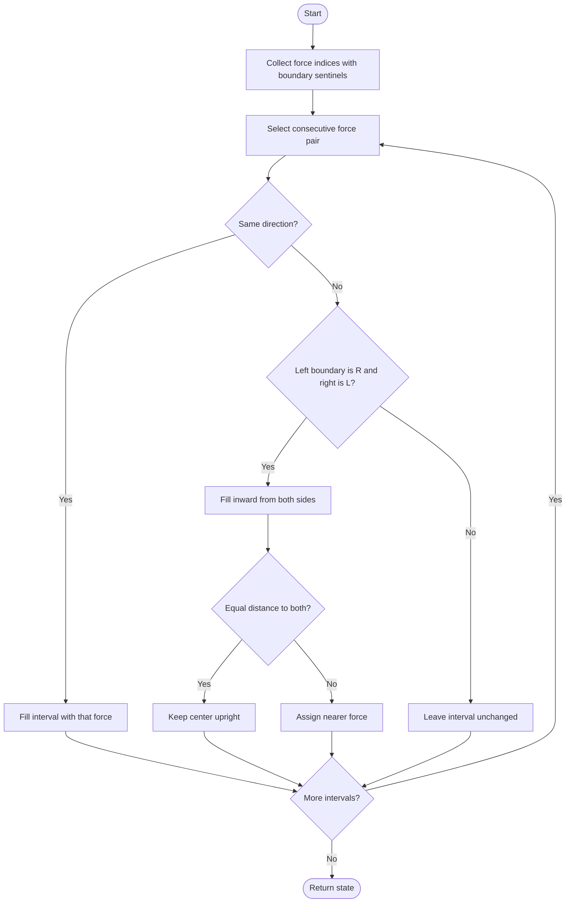

# 838. Push Dominoes

Source: `838.cpp`; `pushDominoes(string dominoes)`.

## 1. Understanding

> **मराठी:** प्रश्नात काय दिले आहे आणि नेमके काय शोधायचे आहे, हे आधी स्पष्ट करा.
> Each domino starts upright (`.`) or pushed left/right (`L`/`R`). Determine the final state after forces settle. Simultaneous opposite forces can leave a center domino standing.

## 2. Worked examples and edges

> **मराठी:** प्रश्नात काय दिले आहे आणि नेमके काय शोधायचे आहे, हे आधी स्पष्ट करा.
> `R...L` becomes `RR.LL`; equal-distance middle stays `.`. `L.....R` remains unchanged because forces point outward. Consecutive same-direction forces fill the gap; empty input remains empty.

## 3. Pattern identification + cheat sheet

> **मराठी:** या clues मुळे योग्य pattern ओळखता येतो; constraints आणि relations नीट तपासा.
> Only initial force positions matter; process intervals between consecutive forces.
> | Boundary forces | Interval result |
> |---|---|
> | `L ... L` | all `L` |
> | `R ... R` | all `R` |
> | `R ... L` | fill inward; possible center dot |
> | `L ... R` | unchanged |

## 4. Approaches

> **मराठी:** सोप्या उपायापासून सुरुवात करा आणि constraints नुसार योग्य optimization निवडा.

- **Simulate one time step at a time — intuitive but potentially many rounds.**
- **Force-distance arrays — linear and explicit.**
- **Sentinel + interval processing — used and optimal:** each gap filled once, `O(n)`.

## 5. Flowchart

> **मराठी:** Flowchart मधील decision, loop आणि termination condition क्रमाने समजून घ्या.

The sentinels `L` before the string and `R` after it make edge gaps follow the same interval logic.

## 6. Algorithm and intuition

> **मराठी:** मुख्य observation समजल्यावर algorithm चे steps लक्षात ठेवणे सोपे होते.
> Record non-dot positions plus sentinels `(-1,L)` and `(n,R)`. For each adjacent pair: same symbols fill the gap; `R...L` compares distances from both ends; `L...R` stays upright.

## 7. Code explanation

> **मराठी:** Code मधील variable आणि condition यांचा algorithm मधील उद्देश समजून घ्या.
> `indexes` and `symbols` store boundaries. `ans` starts as the original string. The loop fills only affected gaps; in an `R...L` interval, equal distances explicitly keep `.`.

## 8. Dry run

> **मराठी:** प्रत्येक महत्त्वाच्या step नंतर variable ची value trace करा.
> | Input gap | Distances | Result |
> |---|---|---|
> | `R...L` | `R` and `L` move inward | `RR.LL` |
> | `L.....R` | forces point outward | unchanged |
> | `R...R` | same direction | `RRRRR` including boundaries' gap |

## 9. Complexity

> **मराठी:** Input size आणि प्रत्येक operation कितीदा चालतो यावरून complexity ठरवा.
> `O(n)` time; `O(n)` space for force positions/symbols and answer.

## 10. Correctness

> **मराठी:** Invariant किंवा तर्क वापरून algorithm योग्य उत्तर देतो हे समजून घ्या.
> Between consecutive original forces, no other initial force exists. Equal forces propagate through the whole gap; opposing `R...L` forces claim exactly positions closer to them, with equal-distance positions tied and upright; `L...R` forces move away from the gap. These cases cover every interval without changing original forces.

## 11. Mistakes / interview traps

> **मराठी:** Boundary, duplicate आणि off-by-one cases स्वतंत्रपणे तपासा.

- Equal-distance center in `R...L` remains upright.
- `L...R` is not filled.
- Sentinels must have matching outward directions (`L` on left, `R` on right).
- Compare distances to the two boundary indices, not to the string edges.

## 12. Quick revision

Mark force boundaries; same forces fill; `R...L` meet in middle; `L...R` stays dots.
मधला equal-distance domino उभाच राहतो.

## 13. Related problems / variations

> **मराठी:** प्रश्नात काय दिले आहे आणि नेमके काय शोधायचे आहे, हे आधी स्पष्ट करा.
> Asteroid Collision; collision simulation; nearest-source / distance-transform problems.

## 14. Self-assessment

> **मराठी:** उत्तर न पाहता प्रश्न सोडवा आणि तुमच्या निवडीचे कारण सांगा.

1. What do the two sentinels represent?
2. Why does `L...R` remain unchanged?
3. How is an odd-length `R...L` gap resolved?
4. Can each empty interval be processed independently?
