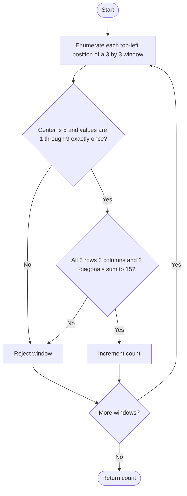

# 840. Magic Squares In Grid

Source: `840.cpp`; brute and center/count optimized validators.

## 1. Understanding

> **मराठी:** प्रश्नात काय दिले आहे आणि नेमके काय शोधायचे आहे, हे आधी स्पष्ट करा.
> Count every `3×3` subgrid that contains 1 through 9 exactly once and has each row, column, and diagonal sum to 15.

## 2. Worked examples and edges

> **मराठी:** प्रश्नात काय दिले आहे आणि नेमके काय शोधायचे आहे, हे आधी स्पष्ट करा.
> The Lo Shu square
> `4 3 8 / 9 5 1 / 2 7 6` is magic. A duplicate value invalidates the square even if some lines sum to 15. Grids smaller than 3 in either dimension contain no candidates; source assumes nonempty grid.

## 3. Pattern identification + cheat sheet

> **मराठी:** या clues मुळे योग्य pattern ओळखता येतो; constraints आणि relations नीट तपासा.
> Fixed-size window enumeration + small-domain validation.
> | Clue | Pattern |
> |---|---|
> | Every 3×3 placement | Sliding/fixed window |
> | Values constrained to 1..9 | Frequency/seen array |
> | Rows, cols, diagonals | Direct constant-size checks |

## 4. Approaches

> **मराठी:** सोप्या उपायापासून सुरुवात करा आणि constraints नुसार योग्य optimization निवडा.

- **Brute validator (`checkGridBrute`) — used:** validate range, uniqueness, and all eight sums.
- **Optimized validator (`checkGridOptimized`) — used:** center must be 5 and values unique, then checks all eight sums. It reduces early checks but remains constant work per window.
- A center-only check is insufficient unless combined with all required validity properties; magic-looking rows do not guarantee distinct values.

## 5. Flowchart

> **मराठी:** Flowchart मधील decision, loop आणि termination condition क्रमाने समजून घ्या.

Check bounds before validating each candidate; only positions with `r+2 < rows` and `c+2 < cols` fit.

## 6. Algorithm and intuition

> **मराठी:** मुख्य observation समजल्यावर algorithm चे steps लक्षात ठेवणे सोपे होते.
> Enumerate all valid top-left corners. For each fixed window, uniqueness/range and line sums establish the magic-square conditions. In a normal 3×3 Lo Shu square the center is 5, used as an early rejection.

## 7. Code explanation

> **मराठी:** Code मधील variable आणि condition यांचा algorithm मधील उद्देश समजून घ्या.
> `numMagicSquaresBrute` calls the explicit validator. `numMagicSquaresOptimized` uses a 10-slot count array, rejects invalid values, checks each count is 1, then evaluates the eight sums. Both return the number of valid windows.

## 8. Dry run

> **मराठी:** प्रत्येक महत्त्वाच्या step नंतर variable ची value trace करा.
> | Check on Lo Shu window | Result |
> |---|---|
> | Center is 5 | pass |
> | Values 1..9 each appear once | pass |
> | Three rows and columns total 15 | pass |
> | Two diagonals total 15 | pass; count +1 |

## 9. Complexity

> **मराठी:** Input size आणि प्रत्येक operation कितीदा चालतो यावरून complexity ठरवा.
> For `R×C`, `O(RC)` time because each 3×3 validation has constant cost; `O(1)` auxiliary space.

## 10. Correctness

> **मराठी:** Invariant किंवा तर्क वापरून algorithm योग्य उत्तर देतो हे समजून घ्या.
> Every 3×3 subgrid is examined once. A validator accepts only when all nine entries are exactly the digits 1..9 and all eight required lines sum to 15, which is exactly the problem definition; incrementing accepted windows gives the desired count.

## 11. Mistakes / interview traps

> **मराठी:** Boundary, duplicate आणि off-by-one cases स्वतंत्रपणे तपासा.

- Test both diagonals as well as rows and columns.
- Check uniqueness, not only total sums.
- Values outside 1..9 must be rejected before indexing the count array.
- Center=5 is a necessary filter, not the complete proof.

## 12. Quick revision

Enumerate windows; require center 5, digits 1..9 once, all 8 sums=15.
Center check हा फक्त filter आहे; बाकी validationही आवश्यक आहे.

## 13. Related problems / variations

> **मराठी:** प्रश्नात काय दिले आहे आणि नेमके काय शोधायचे आहे, हे आधी स्पष्ट करा.
> Sliding-window grid checks; Sudoku validity; Lo Shu square rotations/reflections.

## 14. Self-assessment

> **मराठी:** उत्तर न पाहता प्रश्न सोडवा आणि तुमच्या निवडीचे कारण सांगा.

1. Why is the center required to be 5?
2. Why are 8 line sums checked?
3. Why is the count array size 10?
4. What is the runtime for an `R×C` grid?
