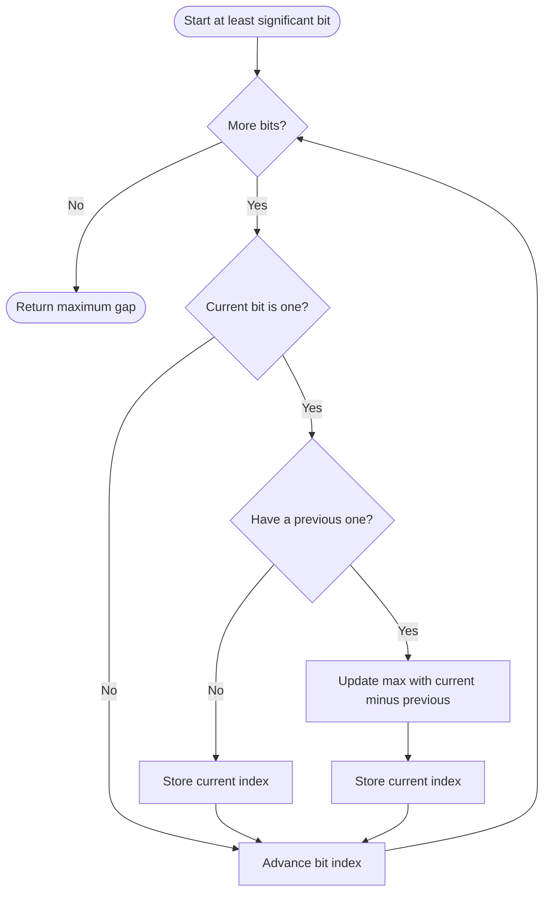

# 868. Binary Gap

Source: `868.cpp`; bitset, right-shift bitwise, and binary-string variants.

## 1. Understanding

> **मराठी:** प्रश्नात काय दिले आहे आणि नेमके काय शोधायचे आहे, हे आधी स्पष्ट करा.
> Return the largest distance between consecutive `1` bits in the binary representation of positive integer `n`. Fewer than two set bits gives 0.

## 2. Worked examples and edges

> **मराठी:** प्रश्नात काय दिले आहे आणि नेमके काय शोधायचे आहे, हे आधी स्पष्ट करा.
> `22 = 10110₂`: gaps are 2 and 1, so answer 2. `8 = 1000₂` has only one `1`, answer 0. `9 = 1001₂` has distance 3.

## 3. Pattern identification + cheat sheet

> **मराठी:** या clues मुळे योग्य pattern ओळखता येतो; constraints आणि relations नीट तपासा.
> Scan set-bit positions and compare consecutive positions.
> | Need | Pattern |
> |---|---|
> | Visit bits | Shift and mask |
> | Consecutive set-bit distance | Remember previous index |
> | Fixed 32-bit bound | Bitset scan |

## 4. Approaches

> **मराठी:** सोप्या उपायापासून सुरुवात करा आणि constraints नुसार योग्य optimization निवडा.

- **Bitset (`binaryGap_bitset`) — fixed-width scan, `O(1)` for 32 bits.**
- **Right shift (`binaryGap_bitwise`) — used efficient approach, `O(log n)` time, `O(1)` space.**
- **Build binary string — easiest to visualize, `O(log n)` time/space.**

## 5. Flowchart

> **मराठी:** Flowchart मधील decision, loop आणि termination condition क्रमाने समजून घ्या.

Zero bits are skipped; only pairs of neighboring set-bit positions matter.

## 6. Algorithm and intuition

> **मराठी:** मुख्य observation समजल्यावर algorithm चे steps लक्षात ठेवणे सोपे होते.
> Scan from least significant bit upward. Each time `n & 1` is one, compute `index-last`, update maximum, and remember the index; then shift right.

## 7. Code explanation

> **मराठी:** Code मधील variable आणि condition यांचा algorithm मधील उद्देश समजून घ्या.
> `last=-1` indicates no prior one. The bitwise variant maintains `index` while shifting. The bitset variant scans high to low but calculates the same distance. The string variant constructs and reverses the binary digits.

## 8. Dry run

> **मराठी:** प्रत्येक महत्त्वाच्या step नंतर variable ची value trace करा.
> | Value `22` scan (LSB index) | Set-bit indices | Gap |
> |---|---|---:|
> | `10110₂` | 1, 2, 4 | 1, then 2 |
> | maximum | — | 2 |

## 9. Complexity

> **मराठी:** Input size आणि प्रत्येक operation कितीदा चालतो यावरून complexity ठरवा.
> Bitwise/string: `O(log n)` time; bitwise `O(1)` space, string `O(log n)` space. Bitset scan is `O(32)=O(1)` for fixed width.

## 10. Correctness

> **मराठी:** Invariant किंवा तर्क वापरून algorithm योग्य उत्तर देतो हे समजून घ्या.
> The scan visits every bit position in order. Whenever it sees a 1 after another 1, their index difference is the distance for that consecutive pair; updating the maximum over every such pair returns the largest gap. If fewer than two are seen, maximum remains zero.

## 11. Mistakes / interview traps

> **मराठी:** Boundary, duplicate आणि off-by-one cases स्वतंत्रपणे तपासा.

- Distance is index difference, not number of zeros between (e.g. `1001` gives 3).
- Ignore leading zeros; they cannot create a gap.
- Keep previous set-bit index, not previous bit position.
- `bitset<32>` assumes a 32-bit representation; the shifting method is more width-flexible for positive inputs.

## 12. Quick revision

Shift through bits; on each 1, update `max(index-last)`; advance index; return zero if no pair.
Gap म्हणजे bit-position मधला फरक, मधल्या zerosची संख्या नव्हे.

## 13. Related problems / variations

> **मराठी:** प्रश्नात काय दिले आहे आणि नेमके काय शोधायचे आहे, हे आधी स्पष्ट करा.
> Number of 1 Bits; Counting Bits; Hamming distance; longest run of set bits.

## 14. Self-assessment

> **मराठी:** उत्तर न पाहता प्रश्न सोडवा आणि तुमच्या निवडीचे कारण सांगा.

1. Why does `1001₂` have gap 3?
2. What does `last=-1` represent?
3. How does `n &= n-1` differ from shifting?
4. Why is the string method not constant space?
