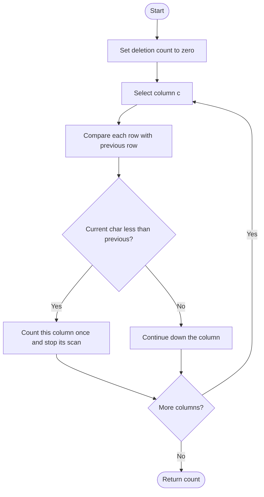

# 944. Delete Columns to Make Sorted

Source: `944.cpp`; column-build/sort and direct-comparison approaches.

## 1. Understanding

> **मराठी:** प्रश्नात काय दिले आहे आणि नेमके काय शोधायचे आहे, हे आधी स्पष्ट करा.
> Given equal-length strings as rows, delete columns that are not nondecreasing from top to bottom. Return the number of deleted columns.

## 2. Worked examples and edges

> **मराठी:** प्रश्नात काय दिले आहे आणि नेमके काय शोधायचे आहे, हे आधी स्पष्ट करा.
> For `["cba","daf","ghi"]`, column 0 is `c,d,g` sorted; column 1 is `b,a,h` not sorted; column 2 is `a,f,i` sorted → delete 1. One row means no column can be unsorted.

## 3. Pattern identification + cheat sheet

> **मराठी:** या clues मुळे योग्य pattern ओळखता येतो; constraints आणि relations नीट तपासा.
> Independently validate each column by checking adjacent rows.
> | Clue | Pattern |
> |---|---|
> | Constraint applies column by column | Outer loop over columns |
> | Nondecreasing order | Compare adjacent rows |
> | Count violations by column | Break after first inversion |

## 4. Approaches

> **मराठी:** सोप्या उपायापासून सुरुवात करा आणि constraints नुसार योग्य optimization निवडा.

- **Build each column and sort it (`minDeletionSize_ColumnBuild`) — correct but extra allocation/sorting.**
- **Direct adjacent comparison (`minDeletionSize_DirectCompare`) — used and preferred:** `O(rows·cols)`, constant extra space.
- Comparing each row as a whole is incorrect; only individual columns are evaluated.

## 5. Flowchart

> **मराठी:** Flowchart मधील decision, loop आणि termination condition क्रमाने समजून घ्या.

One inversion is enough to delete a whole column, so the inner loop stops early.

## 6. Algorithm and intuition

> **मराठी:** मुख्य observation समजल्यावर algorithm चे steps लक्षात ठेवणे सोपे होते.
> For each column `c`, compare `strs[r][c]` with `strs[r-1][c]` for rows `1..m-1`. If any decrease occurs, increment answer once and move to the next column.

## 7. Code explanation

> **मराठी:** Code मधील variable आणि condition यांचा algorithm मधील उद्देश समजून घ्या.
> The direct variant performs the adjacent check and `break`s after finding an inversion. The column-build variant assembles each column, sorts a copy, and compares it to the original.

## 8. Dry run

> **मराठी:** प्रत्येक महत्त्वाच्या step नंतर variable ची value trace करा.
> | Column | Top-to-bottom | Sorted? | Delete? |
> |---:|---|---|---|
> | 0 | `c,d,g` | yes | no |
> | 1 | `b,a,h` | no (`a<b`) | yes |
> | 2 | `a,f,i` | yes | no |

## 9. Complexity

> **मराठी:** Input size आणि प्रत्येक operation कितीदा चालतो यावरून complexity ठरवा.
> Direct: `O(mn)` time, `O(1)` auxiliary space. Build-and-sort: `O(mn log m)` time plus `O(mn)` column storage (and sort copies).

## 10. Correctness

> **मराठी:** Invariant किंवा तर्क वापरून algorithm योग्य उत्तर देतो हे समजून घ्या.
> A column is nondecreasing iff every adjacent pair satisfies `strs[r-1][c] <= strs[r][c]`. The direct scan checks every such pair and counts a column exactly once if any condition fails; hence the count is exactly the number to delete.

## 11. Mistakes / interview traps

> **मराठी:** Boundary, duplicate आणि off-by-one cases स्वतंत्रपणे तपासा.

- Delete a column once even if it has several inversions.
- Equal adjacent letters are allowed.
- Compare top-to-bottom, not left-to-right within strings.
- Source assumes at least one string and consistent widths, as guaranteed by constraints.

## 12. Quick revision

For each column, scan adjacent rows; first decrease means one deletion and break.
एका columnमध्ये अनेक inversions असले तरी delete count एकच वाढतो.

## 13. Related problems / variations

> **मराठी:** प्रश्नात काय दिले आहे आणि नेमके काय शोधायचे आहे, हे आधी स्पष्ट करा.
> Delete Columns to Make Sorted II/III; lexicographic sorting; monotonic sequence validation.

## 14. Self-assessment

> **मराठी:** उत्तर न पाहता प्रश्न सोडवा आणि तुमच्या निवडीचे कारण सांगा.

1. Why is one inversion enough to count a deletion?
2. Are equal adjacent characters valid?
3. Why does sorting the extracted column work?
4. What is the memory advantage of direct comparison?
