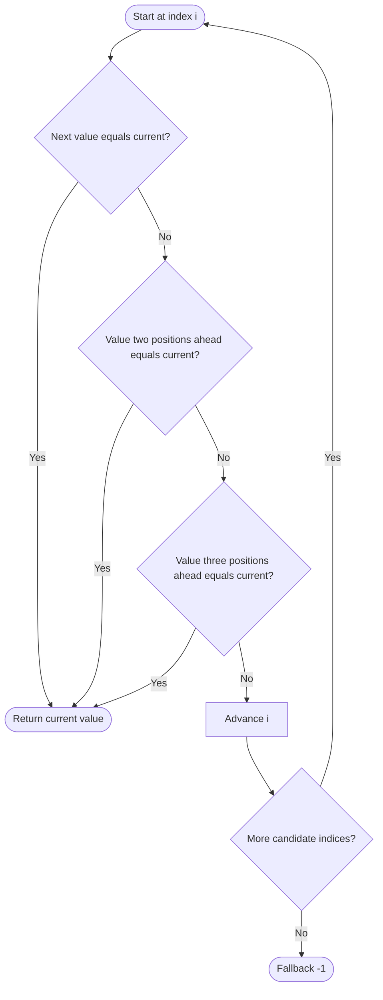

# 961. N-Repeated Element in Size 2N Array

Source: `961.cpp`; frequency map, neighbor-check, and set variants.

## 1. Understanding

> **मराठी:** प्रश्नात काय दिले आहे आणि नेमके काय शोधायचे आहे, हे आधी स्पष्ट करा.
> An array has length `2N`; one value occurs `N` times and all other values are distinct. Return the repeated value.

## 2. Worked examples and edges

> **मराठी:** प्रश्नात काय दिले आहे आणि नेमके काय शोधायचे आहे, हे आधी स्पष्ट करा.
> `[2,1,2,5,3,2]` has length 6 (`N=3`); 2 appears three times. The repeated copies need not all be adjacent. Valid problem inputs guarantee such an element.

## 3. Pattern identification + cheat sheet

> **मराठी:** या clues मुळे योग्य pattern ओळखता येतो; constraints आणि relations नीट तपासा.
> Use the strong frequency guarantee to find a repeat early.
> | Clue | Pattern |
> |---|---|
> | Need value occurring N times | Frequency map |
> | Any duplicate is guaranteed | Seen set |
> | Repeated N times among 2N positions | Check local distance at most 3 |

## 4. Approaches

> **मराठी:** सोप्या उपायापासून सुरुवात करा आणि constraints नुसार योग्य optimization निवडा.

- **Frequency map (`repeatedNTimes_freqMap`) — direct and correct:** stop at count `N`; `O(n)` expected time/space.
- **Set (`repeatedNTimes_set`) — correct under the guarantee:** return first already-seen value; `O(n)` expected time/space.
- **Neighbor check — used constant-space trick:** compare offsets 1, 2, and 3; `O(n)` time, `O(1)` space.
- Searching only adjacent pairs is incorrect because repeats may be separated.

## 5. Flowchart

> **मराठी:** Flowchart मधील decision, loop आणि termination condition क्रमाने समजून घ्या.

If one value fills half the array, some two occurrences must be within three positions.

## 6. Algorithm and intuition

> **मराठी:** मुख्य observation समजल्यावर algorithm चे steps लक्षात ठेवणे सोपे होते.
> The constant-space variant checks `nums[i]` against the next three entries where in bounds. The pigeonhole argument guarantees a pair within distance 3; the other two methods explicitly track seen counts/values.

## 7. Code explanation

> **मराठी:** Code मधील variable आणि condition यांचा algorithm मधील उद्देश समजून घ्या.
> The map increments frequency and returns at `n`. The neighbor method uses safe boundary checks for offsets 2 and 3. The set method returns at the first duplicate. `-1` is a fallback unreachable for valid inputs.

## 8. Dry run

> **मराठी:** प्रत्येक महत्त्वाच्या step नंतर variable ची value trace करा.
> | Index `i` | Compare | Outcome |
> |---:|---|---|
> | 0 (`2`) | next 1, +2 is 2 | return 2 |

## 9. Complexity

> **मराठी:** Input size आणि प्रत्येक operation कितीदा चालतो यावरून complexity ठरवा.
> Neighbor: `O(n)` time, `O(1)` extra space. Map/set: expected `O(n)` time, `O(n)` space.

## 10. Correctness

> **मराठी:** Invariant किंवा तर्क वापरून algorithm योग्य उत्तर देतो हे समजून घ्या.
> The map returns once a value reaches its guaranteed frequency `N`; the set returns a repeated value, which under the input guarantee must be the N-repeated element. For the neighbor method, if all copies were at least distance 4 apart, `N` copies would require at least `4N-3` array positions, exceeding length `2N` for `N>1`; hence a checked pair exists (smallest case also has adjacent copies).

## 11. Mistakes / interview traps

> **मराठी:** Boundary, duplicate आणि off-by-one cases स्वतंत्रपणे तपासा.

- The neighbor trick depends on the exact `N`-of-`2N` guarantee.
- Check bounds before reading offsets.
- First duplicate is safe only because other values are distinct.
- Do not assume duplicates are adjacent.

## 12. Quick revision

Guaranteed repeated half-size value; count, set, or compare next 1/2/3 positions for O(1) space.
Neighbor trick हा inputच्या विशेष guarantee वर अवलंबून आहे.

## 13. Related problems / variations

> **मराठी:** प्रश्नात काय दिले आहे आणि नेमके काय शोधायचे आहे, हे आधी स्पष्ट करा.
> Find the Duplicate Number; first repeated element; majority element; pigeonhole-based array guarantees.

## 14. Self-assessment

> **मराठी:** उत्तर न पाहता प्रश्न सोडवा आणि तुमच्या निवडीचे कारण सांगा.

1. Why is any first duplicate the answer?
2. Why are offsets through 3 sufficient?
3. What guarantee would make the neighbor trick invalid?
4. Which variant uses least extra memory?
