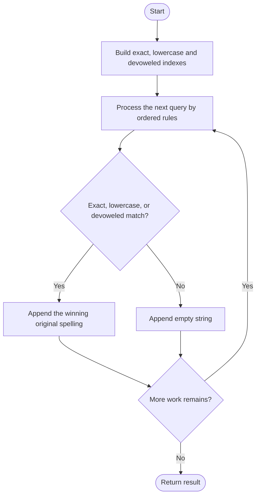
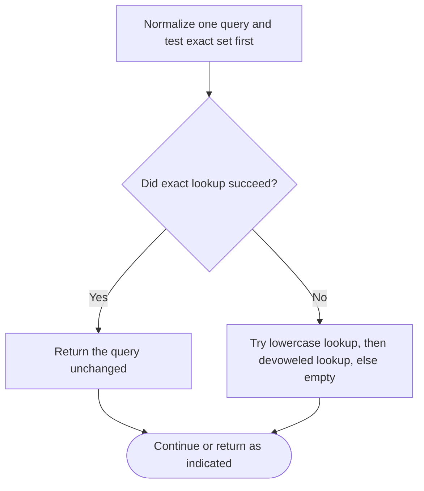

# Vowel Spellchecker — LeetCode 966

## Problem and judge interface

vector<string> spellchecker(vector<string>& wordlist, vector<string>& queries); return a matched word per query.

## Identification evidence

Its exact, lowercase and devoweled lookup indexes enforce the three ordered match rules of problem 966.

## Main flow



## Important branch / loop



## Core logic and invariants

Preprocessing stores exact words plus first-seen original spellings for lowercase and vowel-starred lowercase keys. Each query tests exact match, then case-only match, then vowel-error match, otherwise emits an empty string.

## Complexity

For total input characters C, expected O(C) time and O(C) hash storage.

## Comparison and optimization

Precomputed indexes avoid scanning the whole word list for every query; exact-match precedence is preserved.

## Compile and run

The `.cpp` is the original standalone source, including its local `main()` demonstration where present. Compile and run from the repository root with a C++17 compiler:

```text
g++ -std=c++17 LeetCode\966\966.cpp -o solution.exe
.\solution.exe
```

For LeetCode, adapt the implementation to the required class/method signature and omit the local `main()` and demonstration helpers; use the judge-provided node types. Notes above identify method-name or behavior differences. The moved source bytes have not been edited.
