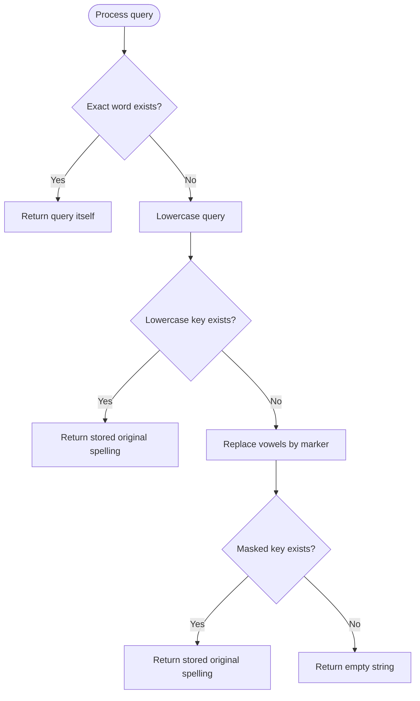

# 966. Vowel Spellchecker

Source: `966.cpp`; `spellchecker(wordlist, queries)`.

## 1. Understanding

> **मराठी:** प्रश्नात काय दिले आहे आणि नेमके काय शोधायचे आहे, हे आधी स्पष्ट करा.
> Resolve each query by priority: exact match; case-insensitive match; then match after treating every vowel as interchangeable. If no rule matches, output an empty string.

## 2. Worked examples and edges

> **मराठी:** प्रश्नात काय दिले आहे आणि नेमके काय शोधायचे आहे, हे आधी स्पष्ट करा.
> With wordlist `["KiTe","kite","hare","Hare"]`, query `"Kite"` gives `"KiTe"` by case rule; query `"HARE"` gives `"hare"` by case-insensitive rule (first matching spelling); `"Hear"` gives `""` because consonants differ. Exact spelling takes precedence.

## 3. Pattern identification + cheat sheet

> **मराठी:** या clues मुळे योग्य pattern ओळखता येतो; constraints आणि relations नीट तपासा.
> Ordered matching rules suggest layered hash indexes keyed by normalized forms.
> | Priority | Key/index |
> |---|---|
> | 1 | Exact word set |
> | 2 | Lowercase word → first original spelling |
> | 3 | Lowercase with vowels masked → first original spelling |

## 4. Approaches

> **मराठी:** सोप्या उपायापासून सुरुवात करा आणि constraints नुसार योग्य optimization निवडा.

- **Scan the wordlist for every query and test all rules — correct but `O(Q·W·L)`.**
- **Precompute sets/maps — used:** build once, then normalize/look up each query. Average `O((W+Q)·L)`.
- Applying vowel masking before case normalization or skipping exact-match priority can return the wrong spelling.

## 5. Flowchart

> **मराठी:** Flowchart मधील decision, loop आणि termination condition क्रमाने समजून घ्या.

The order is part of the specification; do not merge these three checks.

## 6. Algorithm and intuition

> **मराठी:** मुख्य observation समजल्यावर algorithm चे steps लक्षात ठेवणे सोपे होते.
> Pre-index each word in three forms. Preserve the earliest wordlist spelling for normalized keys. For each query, test exact, lowercase, then devoweled-lowercase; stop at the first match.

## 7. Code explanation

> **मराठी:** Code मधील variable आणि condition यांचा algorithm मधील उद्देश समजून घ्या.
> `exactWords` handles exact matches. `caseInsensitiveMap` and `vowelErrorMap` are filled only when a normalized key is absent, preserving first occurrence. `toLower` normalizes case; `devowel` maps `a/e/i/o/u` to `*`.

## 8. Dry run

> **मराठी:** प्रत्येक महत्त्वाच्या step नंतर variable ची value trace करा.
> | Query | Exact? | Lowercase key | Masked key | Result |
> |---|---|---|---|---|
> | `Kite` | no | `kite` → `KiTe` | — | `KiTe` |
> | `HARE` | no | `hare` → `hare` | — | `hare` |
> | `Hear` | no | absent | `h**r` absent | `""` |

## 9. Complexity

> **मराठी:** Input size आणि प्रत्येक operation कितीदा चालतो यावरून complexity ठरवा.
> Let `W,Q` be word/query counts and `L` maximum length: average `O((W+Q)·L)` time and `O(W·L)` index space.

## 10. Correctness

> **मराठी:** Invariant किंवा तर्क वापरून algorithm योग्य उत्तर देतो हे समजून घ्या.
> The exact set implements priority one. The lowercase map contains the earliest original word for every case-folded key, implementing priority two. The masked map contains the earliest original spelling for each vowel-insensitive key, implementing priority three. Ordered lookup returns the first applicable rule, or empty when none applies.

## 11. Mistakes / interview traps

> **मराठी:** Boundary, duplicate आणि off-by-one cases स्वतंत्रपणे तपासा.

- Preserve rule priority exactly.
- Return the original wordlist spelling, not normalized key.
- Only vowels are interchangeable; consonants must match.
- `tolower(char)` is safe under the problem's English-letter constraints; arbitrary signed-byte text needs unsigned-char handling.

## 12. Quick revision

Build exact set + lowercase map + vowel-masked map; query through those in required priority order.
Priority बदलली तर returned spellingही चुकीची होऊ शकते.

## 13. Related problems / variations

> **मराठी:** प्रश्नात काय दिले आहे आणि नेमके काय शोधायचे आहे, हे आधी स्पष्ट करा.
> Autocomplete normalization; case-insensitive dictionary lookup; wildcard matching; canonicalization pipelines.

## 14. Self-assessment

> **मराठी:** उत्तर न पाहता प्रश्न सोडवा आणि तुमच्या निवडीचे कारण सांगा.

1. Why store original spellings in normalized maps?
2. Why must exact match run first?
3. What does the `*` marker represent?
4. How would you make normalized lookup return all matching words?
