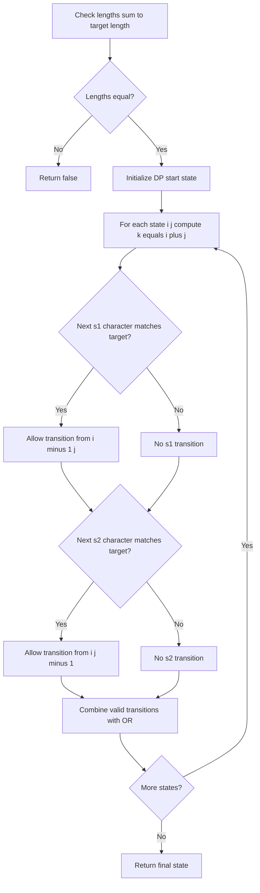

# 97. Interleaving String

## 1. Problem Understanding

Given strings `s1`, `s2`, and `s3`, determine whether `s3` is formed by interleaving `s1` and `s2` while preserving the left-to-right order of characters within each source string. Characters may alternate, but the order inside each source cannot change.

## 2. Example Understanding

- `s1="aabcc", s2="dbbca", s3="aadbbcbcac"` → true: consume the next needed character from either source while preserving each source order.
- Same inputs with `s3="aadbbbaccc"` → false: the total length matches, but no valid order-preserving assignment forms it.
- `s1=""`, `s2="abc"`, `s3="abc"` → true.
- Always first check `|s1|+|s2|=|s3|`; otherwise impossible.

## 3. Problem Identification

### Pattern Recognition Cheat Sheet

| Clue in Question                              | Possible Pattern       | Why?                                         |
| --------------------------------------------- | ---------------------- | -------------------------------------------- |
| Merge two sequences preserving internal order | Two-pointer DP         | State tracks consumed prefix from each input |
| At each step choose source 1 or 2             | Branching recursion    | Both next characters may match               |
| Overlapping choices can reach same indices    | Memoization/tabulation | State `(i,j)` repeats                        |
| Output length is sum of inputs                | Length invariant       | `k` is determined by `i+j`                   |

Ask: What positions have been consumed? Which target character must be matched next? Could both strings provide the same character, requiring both choices to be explored?

## 4. Different Approaches

1. **Plain recursion:** At `(i,j)`, target index is `k=i+j`; branch to `s1[i]` or `s2[j]` if it equals `s3[k]`. Correct but exponential.
2. **Memoization:** Cache whether prefix counts `(i,j)` can form the target prefix. O(mn).
3. **Tabulation:** `dp[i][j]` means first `i` chars of `s1` and first `j` chars of `s2` form first `i+j` chars of `s3`.
4. **Space optimization (provided final):** Keep one row; `dp[j]` before update is from previous `s1` row, `dp[j-1]` is current row.
   | Approach | Time | Space | Pros | Cons |
   |---|---:|---:|---|---|
   | Recursion | Exponential O(2^(m+n)) bound | O(m+n) stack | Direct choices | Repeated states |
   | Memoization | O(mn) | O(mn)+stack | Natural top-down | Recursion overhead |
   | Tabulation | O(mn) | O(mn) | Clear state grid | Full table |
   | 1D DP | O(mn) | O(min(m,n)) possible | Memory efficient | Update ordering is subtle |

## 5. Flowchart

Target position `k=i+j` ठरलेला असतो; प्रत्येक पायरीला source 1 किंवा source 2 मधून पुढचे character घेण्याची valid शक्यता DP मध्ये जोडतो.

## 6. Algorithm / Intuition

Use `dp[i][j]`. The next target character is at index `i+j-1` for the state after consuming `i,j`. State is true if either:

- previous state `(i-1,j)` was true and `s1[i-1]` matches target; or
- previous state `(i,j-1)` was true and `s2[j-1]` matches target.

## 7. Code Explanation

[`97.cpp`](./97.cpp) contains recursive, memoized, tabulated, and one-row variants. Each checks total lengths first. `solveMemo` uses `i+j` to locate the next target character. In tabulation, row/column initialization handles using only one source. In the 1D variant, `dp[j]` is the prior-row state and `dp[j-1]` the current-row state; update left-to-right. The demo skips exponential recursion for larger examples.

## 8. Dry Run

`s1="a", s2="b", s3="ab"`:
| Step | Variables | Condition | Action | Result |
|---|---|---|---|---|
| 1 | `dp[0][0]` | No characters consumed | Initialize true | Start valid |
| 2 | `i=1,j=0` | `s1[0]=='a' == s3[0]` | Take from `s1` | `dp[1][0]=true` |
| 3 | `i=1,j=1` | Target index `1`; `s2[0]=='b'` | Transition from `dp[1][0]` | `dp[1][1]=true` |
| 4 | final state | Both inputs consumed | Return | true |

## 9. Complexity Analysis

There are `(m+1)(n+1)` states and constant work per state: **O(mn)** time. Full table uses O(mn) space. One-row DP uses **O(n)** space (or O(min(m,n)) after choosing the shorter dimension as row width), while recursion stack is absent.

## 10. Why This Solution Works

Every valid interleaving ends by taking its final character from exactly one source: either `s1[i-1]` or `s2[j-1]`. Removing that final character gives one of the two previous states. Conversely, if either previous state is valid and its next source character matches the target's next character, appending it creates a valid interleaving. Induction over `i+j` proves the recurrence. The length check ensures target indexing remains valid.

## 11. Common Mistakes & Interview Traps

- Same character in both sources means both transitions may be possible; do not use `else if`.
- Length equality is necessary, not sufficient.
- Preserve order within each source; this is not arbitrary shuffle.
- In 1D DP, update left-to-right so `dp[j-1]` already represents the current row.
- Base row and column must validate prefixes, not simply mark all true.
- Follow-up: count the number of interleavings instead of returning existence.

## 12. Revision Notes (Quick Recall)

- **Pattern:** Two-string DP / interleaving.
- **Clues:** Merge while preserving each input order.
- **Intuition:** State is how much was consumed from each source; `k=i+j`.
- **Transition:** Take matching next char from either source; OR the possibilities.
- **Complexity:** O(mn) time; O(n) space optimized.
- **Trap:** Both source choices can match at once.
- **Takeaway:** When two sequences build one target, track both consumed-prefix lengths.

## 13. Similar Problem Recognition

Related to distinct subsequences and edit distance because state uses two indices, but transition semantics differ. Merge Strings Alternately is a constructive version. If there are three source strings, state needs three consumed indices and can grow to O(abc); if internal order need not be preserved, this DP model no longer applies.

## 14. Final Self-Assessment

1. Why is target index determined by `i+j`?
2. Why is length equality not enough?
3. What do `dp[i][j]` and its two predecessor states mean?
4. Why must matching choices be combined with OR?
5. Explain the 1D update order.
