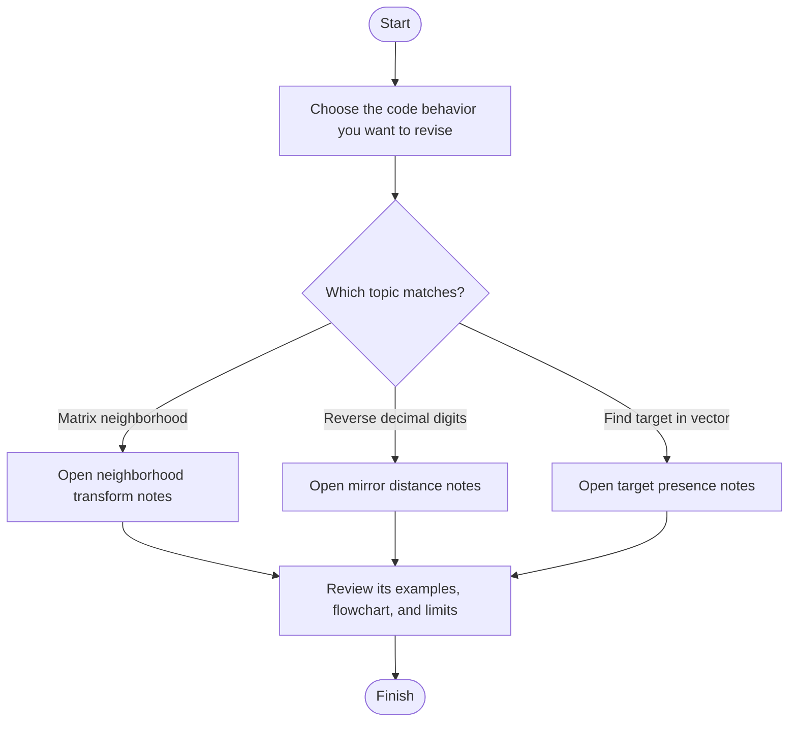

# Unidentified LeetCode Code — Revision Index

> **Scope:** This folder contains three C++ programs, but no verified problem IDs or canonical problem statements. This index and the linked notes describe observable source behavior only; they do not guess official problem requirements.

## 1. Purpose

Use this page to choose the right code-specific revision note. या folder मधील नावं descriptive आहेत; ती official problem titles असल्याची खात्री नाही.

## 2. Identification status

> **मराठी:** या clues मुळे योग्य pattern ओळखता येतो; constraints आणि relations नीट तपासा.
> The solutions remain “unidentified” because their source names, method signatures, and behavior do not establish unique LeetCode IDs. No IDs are assigned here.

## 3. Available solutions

> **मराठी:** या clues मुळे योग्य pattern ओळखता येतो; constraints आणि relations नीट तपासा.
> | Code-derived topic | Revision notes | Source |
> |---|---|---|
> | 3×3 neighborhood sum, square-root transform, maximum scan | [Neighborhood transform](./max-farm-land-neighborhood-transform/README.md) | `max-farm-land-neighborhood-transform/max-farm-land-neighborhood-transform.cpp` |
> | Decimal digit reversal and absolute difference | [Mirror distance](./mirror-distance-number-reversal/README.md) | `mirror-distance-number-reversal/mirror-distance-number-reversal.cpp` |
> | Check whether a target occurs in a vector | [Target presence](./target-presence-check-min-operations/README.md) | `target-presence-check-min-operations/target-presence-check-min-operations.cpp` |

## 4. How to use this index

> **मराठी:** सोप्या उपायापासून सुरुवात करा आणि constraints नुसार योग्य optimization निवडा.
> Select a code-derived topic above, then read its complete standalone note for signatures, examples, flowchart, complexity, assumptions, and self-test. The linked note is authoritative for details of its corresponding implementation.

## 5. Evidence policy

> **मराठी:** Flowchart मधील decision, loop आणि termination condition क्रमाने समजून घ्या.
> Descriptions are checked against the C++ files in this folder tree. Where a canonical statement or constraints are unavailable, the notes say so instead of inventing requirements.

## 6. Problem coverage

> **मराठी:** प्रश्नात काय दिले आहे आणि नेमके काय शोधायचे आहे, हे आधी स्पष्ट करा.
> There is no shared input format or single problem that covers all three programs. Each source has its own hard-coded local demonstration `main()`; consult its note for the method-specific behavior.

## 7. Concepts represented

- Matrix neighborhood traversal and boundary checks
- Decimal digit extraction and reversal
- Linear search with a set used as a presence marker
  ही विषयांची यादी आहे; ती एकाच algorithm ची तुलना नाही.

## 8. Navigation flowchart

> **मराठी:** Flowchart मधील decision, loop आणि termination condition क्रमाने समजून घ्या.

## 9. Source-to-note mapping

> **मराठी:** Code मधील variable आणि condition यांचा algorithm मधील उद्देश समजून घ्या.
> Each child README names the C++ file it documents. The root page intentionally summarizes the collection rather than duplicating all implementation walkthroughs.

## 10. Comparison guidance

> **मराठी:** सोप्या उपायापासून सुरुवात करा आणि constraints नुसार योग्य optimization निवडा.
> These are different code exercises, not interchangeable approaches to one stated problem. Compare variants only where a child note says the source contains alternatives—for example, the three digit-reversal methods.

## 11. Complexity overview

> **मराठी:** Input size आणि प्रत्येक operation कितीदा चालतो यावरून complexity ठरवा.
> Complexity depends on each program's input shape and implementation: vector scan, number of digits, or matrix dimensions. See the relevant child note for the accurate bound and auxiliary-space assumptions.

## 12. Known limits

> **मराठी:** दोन मिनिटांच्या revision साठी pattern, मुख्य कल्पना आणि complexity आठवा.
> No canonical statements, official constraints, or problem IDs were found in this folder's source and notes. Method names and descriptive folder names alone are not sufficient evidence to infer them.

## 13. Revision checklist

> **मराठी:** दोन मिनिटांच्या revision साठी pattern, मुख्य कल्पना आणि complexity आठवा.
> For any solution here, revise in this order: identify the actual code behavior → trace a small example → review boundary cases and assumptions → recall complexity → answer the child note's self-assessment.

## 14. Self-assessment

> **मराठी:** उत्तर न पाहता प्रश्न सोडवा आणि तुमच्या निवडीचे कारण सांगा.

1. Do the folder names prove the official problem titles or IDs?
2. Where should you look for the exact method signature and complexity of one program?
3. Do these three solutions share one input format?
