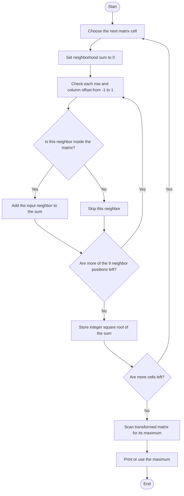

# 3×3 Neighborhood Square-Root Transform — Code Revision Notes

> **Identification:** Problem ID and canonical statement are unknown. This note describes the code in [`max-farm-land-neighborhood-transform.cpp`](./max-farm-land-neighborhood-transform.cpp); “farm land” in the old filename is not enough to infer the official task.

## 1. Purpose

Revise how the program transforms a matrix: for each cell, sum the available values in its surrounding 3×3 area, take the square root, store it as an integer, and later find the largest stored value. प्रत्येक cell साठी जवळच्या cells ची बेरीज करून तिचे square root घेतले जाते.

## 2. Code-derived task

> **मराठी:** Code मधील variable आणि condition यांचा algorithm मधील उद्देश समजून घ्या.
> Given a non-empty rectangular integer matrix `c`, `GetMaxFarm` writes the transformed values into a caller-provided matrix `d`. `getMaxInDP` separately returns the maximum value in a non-empty matrix.

## 3. Identification status

> **मराठी:** या clues मुळे योग्य pattern ओळखता येतो; constraints आणि relations नीट तपासा.
> The source functions and sample matrices do not uniquely identify a LeetCode problem. The official input constraints and intended semantics are unknown.

## 4. Input and output

> **मराठी:** प्रश्नात काय दिले आहे आणि नेमके काय शोधायचे आहे, हे आधी स्पष्ट करा.

- `void GetMaxFarm(vector<vector<int>>& c, vector<vector<int>>& d)`
- `int getMaxInDP(const vector<vector<int>>& dp)`
- `printvector` prints a matrix; `main()` constructs two fixed 5×5 matrices, transforms them, prints them, and reports each transformed maximum.
- The code expects the output matrix to be pre-sized to match the input and zero-initialized before the single transform call. There is no stdin/stdout judge protocol.

## 5. Approach

> **मराठी:** सोप्या उपायापासून सुरुवात करा आणि constraints नुसार योग्य optimization निवडा.
> Visit each coordinate `(i, j)`. Add the center and each neighbor whose row and column are in bounds, then assign `sqrt(sum)` to `d[i][j]`. C++ converts that floating-point result to `int`, truncating the fractional part. A separate full scan finds the maximum transformed value.

## 6. Dry Run

> **मराठी:** प्रत्येक महत्त्वाच्या step नंतर variable ची value trace करा.
> For the 3×3 matrix `{{1,0,1},{0,1,0},{1,0,1}}`, trace the center and a corner:
> | Input | State | Action | Result |
> |---|---|---|---|
> | Center `(1,1)` | Sum `0` | Add all nine in-bounds values | Sum `5` |
> | Center `(1,1)` | Sum `5` | Store `int(sqrt(5))` | `d[1][1] = 2` |
> | Corner `(0,0)` | Sum `0` | Add its in-bounds 2×2 values | Sum `2` |
> | Corner `(0,0)` | Sum `2` | Store `int(sqrt(2))` | `d[0][0] = 1` |

## 7. Pseudocode

> **मराठी:** Code मधील variable आणि condition यांचा algorithm मधील उद्देश समजून घ्या.

```text
for every cell (row, column):
    sum all input cells within one row and one column, if in bounds
    output[row][column] = integer square root of sum
scan output and return its largest value
```

## 8. Flowchart

> **मराठी:** Flowchart मधील decision, loop आणि termination condition क्रमाने समजून घ्या.



## 9. Code-specific explanation

> **मराठी:** Code मधील variable आणि condition यांचा algorithm मधील उद्देश समजून घ्या.
> `GetMaxFarm` implements boundary checks explicitly for the top, middle, and bottom rows of the neighborhood; horizontal neighbors are checked separately. It adds into `d[i][j]` before taking the square root, so callers must pass a zero-filled `d` (as `main()` does) and should not reuse a previously transformed matrix. `getMaxInDP` starts with `dp[0][0]` and scans all entries. `main()` calls it after each transformation; `GetMaxFarm` itself does not return the maximum.

## 10. Correctness note

> **मराठी:** Invariant किंवा तर्क वापरून algorithm योग्य उत्तर देतो हे समजून घ्या.
> For each coordinate, every valid offset in `{-1,0,1} × {-1,0,1}` is included once, and out-of-bounds offsets are skipped. Thus the accumulated sum is exactly that cell's in-bounds 3×3 neighborhood. Its integer square root is stored, and the later complete scan returns the largest stored value.

## 11. Complexity

> **मराठी:** Input size आणि प्रत्येक operation कितीदा चालतो यावरून complexity ठरवा.
> For an `R × C` matrix:

- **Time:** `O(RC)` for transformation, since at most nine positions are checked per cell; another `O(RC)` for maximum scan.
- **Auxiliary/output space:** `O(RC)` for matrix `d`; the maximum scan itself uses `O(1)` extra space.

## 12. Edge cases and limits

> **मराठी:** Boundary, duplicate आणि off-by-one cases स्वतंत्रपणे तपासा.

- Boundary cells use fewer than nine values, as shown by the bounds checks.
- `c` must be non-empty and rectangular: the code reads `c[0]`.
- `d` must already have at least `R` rows and `C` columns and be zero-initialized.
- `getMaxInDP` also assumes a non-empty matrix.
- The square root assumes non-negative neighborhood sums; negative inputs are not addressed.
- The square root is truncated when stored in `int`, not rounded to the nearest integer.

## 13. Quick revision

> **मराठी:** दोन मिनिटांच्या revision साठी pattern, मुख्य कल्पना आणि complexity आठवा.
> **Remember:** for each cell, inspect the 3×3 window → skip out-of-bounds coordinates → sum → `sqrt` then integer conversion → scan transformed matrix for maximum. The transform and maximum scan are separate functions.

## 14. Self-assessment

> **मराठी:** उत्तर न पाहता प्रश्न सोडवा आणि तुमच्या निवडीचे कारण सांगा.

1. How many input cells contribute to a corner in a matrix with at least two rows and columns?
2. What integer is stored when a neighborhood sum is `8`?
3. Does `GetMaxFarm` itself return the matrix maximum?

## Compile and run

> **मराठी:** उत्तर न पाहता प्रश्न सोडवा आणि तुमच्या निवडीचे कारण सांगा.
> From the repository root, with a C++17 compiler:

```powershell
g++ -std=c++17 "LeetCode\Unidentified\max-farm-land-neighborhood-transform\max-farm-land-neighborhood-transform.cpp" -o solution.exe
.\solution.exe
```
