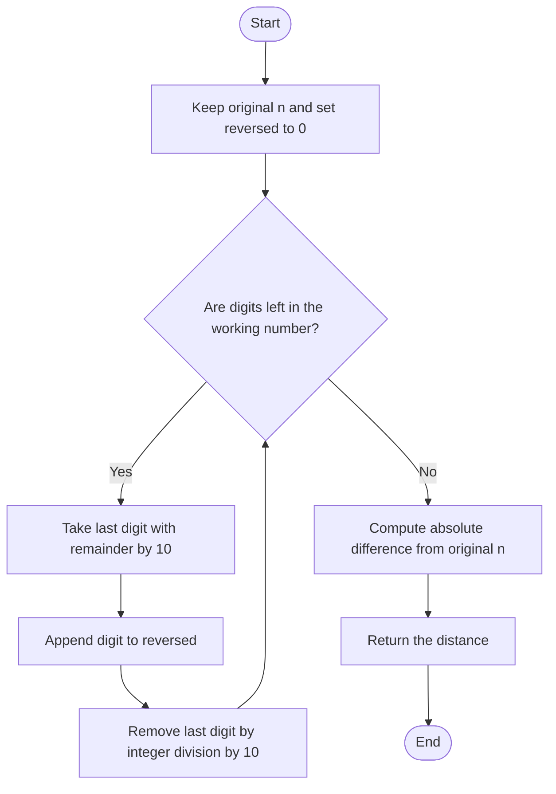

# Mirror Distance by Digit Reversal — Code Revision Notes

> **Identification:** Problem ID and canonical statement are unknown. This note documents the implementations in [`mirror-distance-number-reversal.cpp`](./mirror-distance-number-reversal.cpp), without assuming an official definition of “mirror distance.”

## 1. Purpose

Quickly revise the source's three ways to reverse a non-negative decimal integer, then take its absolute difference from the original. म्हणजे digits उलट करून दोन्ही संख्यांमधील फरक काढायचा.

## 2. Code-derived task

> **मराठी:** Code मधील variable आणि condition यांचा algorithm मधील उद्देश समजून घ्या.
> For a non-negative integer `n`, compute `abs(n - reverse(n))`. This is inferred from the code only, not a verified canonical problem statement.

## 3. Identification status

> **मराठी:** या clues मुळे योग्य pattern ओळखता येतो; constraints आणि relations नीट तपासा.
> The source provides `mirrorDistanceMath`, `mirrorDistanceString`, and `mirrorDistanceStack`; these names and behavior do not establish a unique LeetCode problem or required constraints.

## 4. Input and output

> **मराठी:** प्रश्नात काय दिले आहे आणि नेमके काय शोधायचे आहे, हे आधी स्पष्ट करा.

- Public methods: `int mirrorDistanceMath(int n)`, `int mirrorDistanceString(int n)`, `int mirrorDistanceStack(int n)`
- Private helpers: `reverseMath(int n)` and `reverseString(int n)`
- Each public method returns an integer distance.
- The local `main()` tests fixed values; it does not read judge input.

## 5. Approach

> **मराठी:** सोप्या उपायापासून सुरुवात करा आणि constraints नुसार योग्य optimization निवडा.
> All three methods reverse the base-10 digits, then subtract the reversed number from `n` and take `abs`. Math builds the number digit by digit; string reverses a decimal string; stack stores digits and reconstructs the reversed value.

## 6. Dry Run

> **मराठी:** प्रत्येक महत्त्वाच्या step नंतर variable ची value trace करा.
> For `n = 1200`, preserve the original while extracting and appending digits:
> | Input | State | Action | Result |
> |---|---|---|---|
> | `n = 1200` | Working `n=1200`, reversed `0` | Extract `n % 10` | Digit `0` |
> | `n = 1200` | Working `n=120`, reversed `0` | Append extracted digit `0` | Reversed `0` |
> | `n = 1200` | Working `n=12`, reversed `0` | Extract and append digit `2` | Reversed `2` |
> | `n = 1200` | Working `n=1`, reversed `2` | Extract and append digit `1` | Reversed `21` |
> | `n = 1200` | Working `n=0`, reversed `21` | Compute `abs(original - reversed)` | Distance `1179` |

## 7. Pseudocode

> **मराठी:** Code मधील variable आणि condition यांचा algorithm मधील उद्देश समजून घ्या.

```text
reversed = 0
while n is not zero:
    digit = n mod 10
    reversed = reversed * 10 + digit
    n = n / 10
return absolute difference between original and reversed
```

## 8. Flowchart

> **मराठी:** Flowchart मधील decision, loop आणि termination condition क्रमाने समजून घ्या.



## 9. Code-specific explanation

> **मराठी:** Code मधील variable आणि condition यांचा algorithm मधील उद्देश समजून घ्या.

- `reverseMath` repeatedly uses `% 10` and `/= 10`.
- `reverseString` applies `to_string`, reverses the characters, then uses `stoi`.
- `mirrorDistanceStack` pushes extracted digits and pops them into a new number; the stack method uses `O(d)` extra space.
- The `main()` compares all three methods for `123`, `100`, `1`, `909`, `1200`, and `45678`.

## 10. Correctness note

> **मराठी:** Invariant किंवा तर्क वापरून algorithm योग्य उत्तर देतो हे समजून घ्या.
> In the arithmetic helper, after each iteration, `result` contains the digits already removed from the working number in reverse order. Each remaining digit is appended at the ones place of the working number and the tens-and-higher places of `result`. Once no digits remain, `result` is the decimal reversal; all methods then calculate the same absolute difference.

## 11. Complexity

> **मराठी:** Input size आणि प्रत्येक operation कितीदा चालतो यावरून complexity ठरवा.
> Let `d` be the number of decimal digits.

- **Time:** `O(d)` for each approach.
- **Auxiliary space:** arithmetic reversal `O(1)`; string reversal `O(d)`; stack reversal `O(d)`.

## 12. Edge cases and limits

> **मराठी:** Boundary, duplicate आणि off-by-one cases स्वतंत्रपणे तपासा.

- `0` yields `0` in all three implementations.
- Leading zeroes in the reversed representation are discarded (`1200` becomes `21`).
- Code behavior is reliable only for values whose reversed representation and difference fit in `int`.
- Negative inputs are not handled consistently: the string method can fail on the reversed minus sign, and the stack method ignores negative values. The code gives no verified constraints.

## 13. Quick revision

> **मराठी:** दोन मिनिटांच्या revision साठी pattern, मुख्य कल्पना आणि complexity आठवा.
> **Remember:** extract last digit → append to reversed number → continue → take `abs(original - reversed)`. Pick arithmetic for constant extra space; use string or stack to compare techniques.

## 14. Self-assessment

> **मराठी:** उत्तर न पाहता प्रश्न सोडवा आणि तुमच्या निवडीचे कारण सांगा.

1. What distance does `n = 100` produce?
2. Why does reversing `1200` produce `21`, not `0021`?
3. Which implementation uses constant auxiliary space?

## Compile and run

> **मराठी:** उत्तर न पाहता प्रश्न सोडवा आणि तुमच्या निवडीचे कारण सांगा.
> From the repository root, with a C++17 compiler:

```powershell
g++ -std=c++17 "LeetCode\Unidentified\mirror-distance-number-reversal\mirror-distance-number-reversal.cpp" -o solution.exe
.\solution.exe
```
