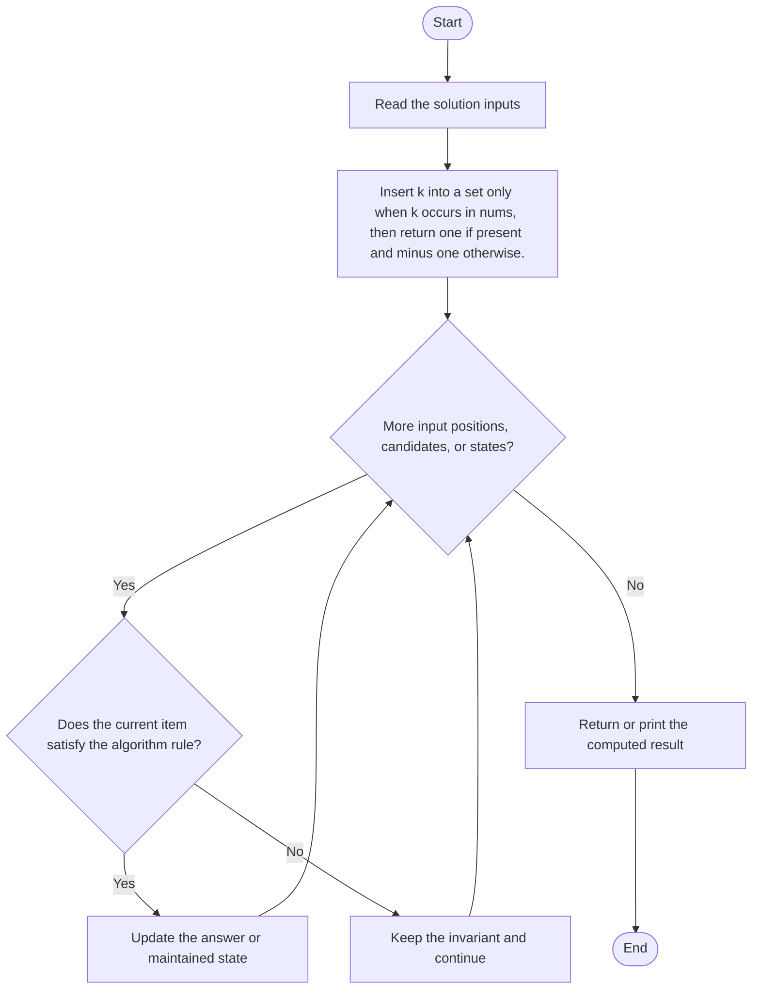
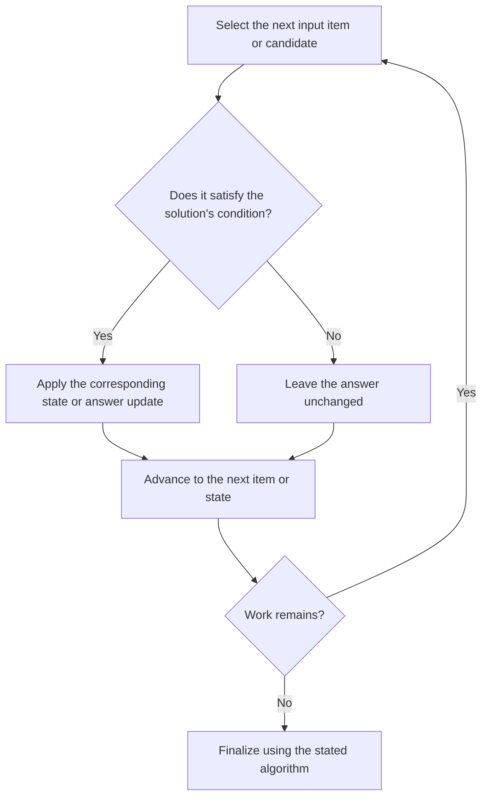

# Target-Presence Check (problem ID unknown)

**Problem ID:** Unknown; no problem number assigned  
**Source:** `minOperations09042025.cpp`  
**Expected format:** C++ class-method solution with a local demonstration `main()`; see compile guidance below.

## Expected input and output / judge signature

Solution-facing declarations extracted from the source:

- `int minOperations(vector<int>& nums, int k)`
  The inputs and return value are described by these parameter and return types. The local `main()` runs test examples; it does not define a judge stdin/stdout protocol.

## Identification evidence

The source behavior is: Insert k into a set only when k occurs in nums, then return one if present and minus one otherwise. The checked method names, signatures, comments, and behavior do not establish a unique LeetCode number.

## Main flow

Insert k into a set only when k occurs in nums, then return one if present and minus one otherwise.



## Important branch and loop flow

The repeated step processes the next input item, candidate, or state. The branch either applies the algorithm's update or leaves the state unchanged, then continues until no work remains.



## Core logic and invariant

Insert k into a set only when k occurs in nums, then return one if present and minus one otherwise.
After each processed item or recursive state, the algorithm's maintained state represents the work accepted so far under the rule above; the final result is read from that accumulated state or returned by the terminal case.

## Complexity

- **Time:** O(n) expected.
- **Auxiliary space:** O(1).

## Compile and run

This source includes a demonstration `main()` and can be compiled with a C++17 compiler from the repository root:

```powershell
g++ -std=c++17 "LeetCode\Unidentified\target-presence-check-min-operations\target-presence-check-min-operations.cpp" -o solution.exe
.\solution.exe
```

For LeetCode's class-method judge, use the relevant method signature above and adapt the local harness: remove the demonstration `main()` and reconcile locally declared node/helper types with judge-provided definitions. Source bytes were preserved exactly during the move.
