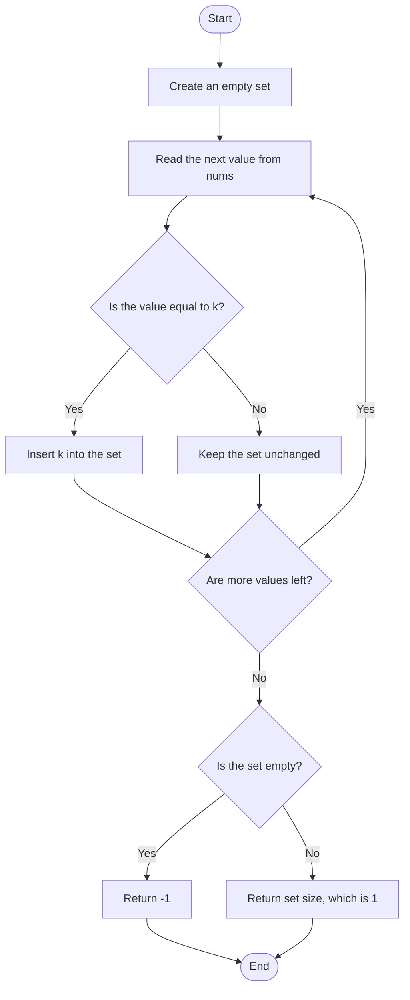

# Target-Presence Check — Code Revision Notes

> **Identification:** Problem ID and canonical statement are unknown. This note describes only the behavior visible in [`target-presence-check-min-operations.cpp`](./target-presence-check-min-operations.cpp); it does not claim that behavior is the intended meaning of the method name.

## 1. Purpose

Revision goal: quickly recall what this particular C++ implementation does. सोप्या शब्दांत, `nums` मध्ये `k` आहे का ते तपासले जाते.

## 2. Code-derived task

> **मराठी:** Code मधील variable आणि condition यांचा algorithm मधील उद्देश समजून घ्या.
> Scan an integer vector; return `-1` if the target never occurs, otherwise return `1`. The official problem wording cannot be established from the available files.

## 3. Identification status

> **मराठी:** या clues मुळे योग्य pattern ओळखता येतो; constraints आणि relations नीट तपासा.
> The method is named `minOperations`, but the code does not count operations: it returns a presence indicator. No unique LeetCode problem or expected semantics can be verified.

## 4. Input and output

> **मराठी:** प्रश्नात काय दिले आहे आणि नेमके काय शोधायचे आहे, हे आधी स्पष्ट करा.

- Method: `int minOperations(vector<int>& nums, int k)`
- Input: integer vector `nums` and target integer `k`
- Output: `1` when at least one element equals `k`; `-1` otherwise
- The local `main()` uses hard-coded examples; there is no stdin/stdout judge protocol.

## 5. Approach

Visit each value and insert `k` into an `unordered_set` when a match is found. Since every inserted value is `k`, the set can contain at most one element. शेवटी set रिकामा आहे का हे पाहून उत्तर मिळते.

## 6. Dry Run

> **मराठी:** प्रत्येक महत्त्वाच्या step नंतर variable ची value trace करा.
> For `nums = {1, 3, 3, 5}`, `k = 3`, trace the scan and set:
> | Input | State | Action | Result |
> |---|---|---|---|
> | `1`, `k=3` | Set `{}` | Compare; values differ | Set remains `{}` |
> | First `3`, `k=3` | Set `{}` | Match; insert `k` | Set becomes `{3}` |
> | Second `3`, `k=3` | Set `{3}` | Match; insert duplicate `k` | Set remains `{3}` |
> | `5`, `k=3` | Set `{3}` | Compare; values differ | Set remains `{3}` |
> | End of input | Set `{3}` | Return set size | Result `1` |

## 7. Pseudocode

> **मराठी:** Code मधील variable आणि condition यांचा algorithm मधील उद्देश समजून घ्या.

```text
create an empty set
for each value in nums:
    if value equals k:
        insert k into the set
if the set is empty: return -1
otherwise: return set size
```

## 8. Flowchart

> **मराठी:** Flowchart मधील decision, loop आणि termination condition क्रमाने समजून घ्या.



## 9. Code-specific explanation

> **मराठी:** Code मधील variable आणि condition यांचा algorithm मधील उद्देश समजून घ्या.
> `Solution::minOperations` owns the entire algorithm. Its range-based `for` loop checks every integer. `unordered_set<int>` removes duplicate insertions, so repeated matches do not change the result. The sample `main()` includes present, absent, empty-vector, and repeated-target cases; it prints each method result.

## 10. Correctness note

> **मराठी:** Invariant किंवा तर्क वापरून algorithm योग्य उत्तर देतो हे समजून घ्या.
> After processing any prefix of `nums`, the set is empty exactly when that prefix contains no `k`; otherwise it contains exactly `{k}`. Thus after the full scan, emptiness distinguishes absence and the set size is `1` for presence.

## 11. Complexity

> **मराठी:** Input size आणि प्रत्येक operation कितीदा चालतो यावरून complexity ठरवा.

- **Time:** expected `O(n)` for `n = nums.size()`; each hash-set operation is expected `O(1)`.
- **Auxiliary space:** `O(1)`, because only `k` can be inserted.

## 12. Edge cases and limits

> **मराठी:** Boundary, duplicate आणि off-by-one cases स्वतंत्रपणे तपासा.

- Empty vector: returns `-1`.
- One or many matches: returns `1`, not the number of matches.
- No match: returns `-1`.
- Actual operation-count semantics, constraints, or required behavior beyond this code are unknown.

## 13. Quick revision

> **मराठी:** दोन मिनिटांच्या revision साठी pattern, मुख्य कल्पना आणि complexity आठवा.
> **Remember:** scan → check equality → set records presence → return `-1` or `1`. `minOperations` is the source method name, not evidence that operations are counted.

## 14. Self-assessment

> **मराठी:** उत्तर न पाहता प्रश्न सोडवा आणि तुमच्या निवडीचे कारण सांगा.

1. What does the method return for `{4, 4, 4}` with `k = 4`?
2. Why does inserting a repeated match not increase the returned value?
3. What result does an empty vector produce?

## Compile and run

> **मराठी:** उत्तर न पाहता प्रश्न सोडवा आणि तुमच्या निवडीचे कारण सांगा.
> From the repository root, with a C++17 compiler:

```powershell
g++ -std=c++17 "LeetCode\Unidentified\target-presence-check-min-operations\target-presence-check-min-operations.cpp" -o solution.exe
.\solution.exe
```
